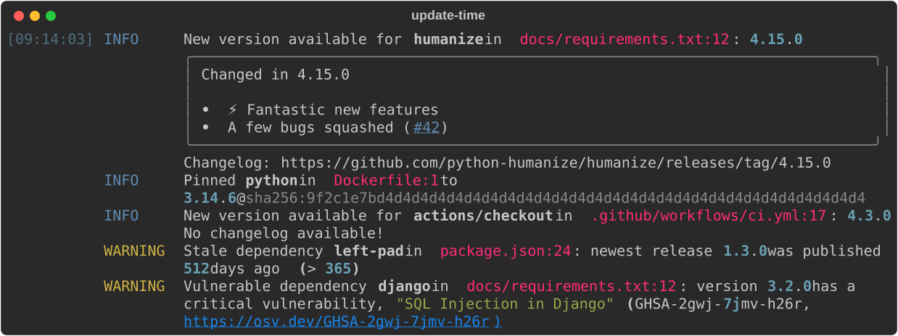

# Update-time - it's time to update your dependencies

[](https://pypi.org/project/update-time/) [](https://pypi.org/project/update-time/) [](https://github.com/ICTU/update-time/blob/main/LICENSE)

Keeping dependencies up-to-date is an important aspect of software maintenance. Update-time is a command line tool that scans your repository for [dependencies](#-what-is-updated) and updates them to their latest versions. Where possible, it [pins](#-pinning) references — no more `latest` — and adds hashes. To protect against supply chain attacks, it applies a [cooldown](#-cooldown) period. And it warns you about [stale dependencies](#-stale-dependencies), [yanked versions](#-yanked-dependencies), [vulnerable dependencies](#-vulnerable-dependencies), and [archived dependencies](#-archived-dependencies).

Update-time rewrites the files in place and logs what it did:



<details>
<summary>The same output as text</summary>

```console
[09:14:03] INFO     New version available for humanize in docs/requirements.txt:12: 4.15.0
                    ╭──────────────────────────────────────────────────────────────────────────────╮
                    │ Changed in 4.15.0                                                            │
                    │                                                                              │
                    │  • ⚡ Fantastic new features                                                 │
                    │  • A few bugs squashed (#42)                                                 │
                    ╰──────────────────────────────────────────────────────────────────────────────╯
                    Changelog: https://github.com/python-humanize/humanize/releases/tag/4.15.0
           INFO     Pinned python in Dockerfile:1 to
                    3.14.6@sha256:9f2c1e7bd4d4d4d4d4d4d4d4d4d4d4d4d4d4d4d4d4d4d4d4d4d4d4d4d4d4d4d4
           INFO     New version available for actions/checkout in .github/workflows/ci.yml:17: 4.3.0
                    No changelog available!
           WARNING  Stale dependency left-pad in package.json:24: newest release 1.3.0 was published
                    512 days ago (> 365)
           WARNING  Vulnerable dependency django in docs/requirements.txt:12: version 3.2.0 has a
                    critical vulnerability, "SQL Injection in Django" (GHSA-2gwj-7jmv-h26r,
                    https://osv.dev/GHSA-2gwj-7jmv-h26r)
```

</details>

## ☰ Table of contents

- [⚡ Usage](#-usage)
  - [Getting started](#getting-started)
  - [Log levels](#log-levels)
  - [Workflow](#workflow)
  - [Increasing rate limits](#increasing-rate-limits)
- [🔄 Updating](#-updating)
  - [📦 What is updated](#-what-is-updated)
  - [📌 Pinning](#-pinning)
  - [⏳ Cooldown](#-cooldown)
- [⚠️ Warnings](#-warnings)
  - [🕸️ Stale dependencies](#-stale-dependencies)
  - [🚫 Yanked dependencies](#-yanked-dependencies)
  - [🛡️ Vulnerable dependencies](#-vulnerable-dependencies)
  - [🗄️ Archived dependencies](#-archived-dependencies)
- [🎛️ Controlling updates and warnings per reference](#-controlling-updates-and-warnings-per-reference)
  - [The anatomy of a marker](#the-anatomy-of-a-marker)
  - [Holding a reference back](#holding-a-reference-back)
  - [Silencing a warning](#silencing-a-warning)
  - [Overriding a command-line option](#overriding-a-command-line-option)
  - [Adopting hash drift](#adopting-hash-drift)
  - [Keeping a pin floating](#keeping-a-pin-floating)
  - [Bounding an update](#bounding-an-update)
  - [Writing a marker](#writing-a-marker)
  - [Seeing what a marker did](#seeing-what-a-marker-did)
  - [Redundant markers](#redundant-markers)
  - [Invalid markers](#invalid-markers)
- [📖 Details per dependency type](#-details-per-dependency-type)
  - [Python dependencies](#python-dependencies)
  - [npm and pnpm dependencies](#npm-and-pnpm-dependencies)
  - [Maven dependencies](#maven-dependencies)
  - [GitHub Actions and pre-commit hooks](#github-actions-and-pre-commit-hooks)
  - [Node engine version and Python version](#node-engine-version-and-python-version)
  - [Docker images](#docker-images)
  - [jsDelivr npm URLs](#jsdelivr-npm-urls)
- [📮 Point of contact](#-point-of-contact)

## ⚡ Usage

### Getting started

Run Update-time without installing it using [uvx](https://docs.astral.sh/uv/):

```console
uvx update-time
```

Or install it as a [uv tool](https://docs.astral.sh/uv/concepts/tools/) so it's always available on your `PATH`:

```console
uv tool install update-time
update-time
```

<details>
<summary>Running <code>update-time -h</code> shows the full command-line interface</summary>

```console
$ update-time -h
usage: update-time [-h] [-V] [--cooldown DAYS] [--stale-after DAYS]
                   [--vulnerability-level {low,moderate,high,critical}]
                   [--ignore-vulnerability IDS] [--exclude-path PATHS]
                   [--force] [--log-level {DEBUG,INFO,WARNING,ERROR}]
                   [PATH]

Scan the PATH for pinned dependencies and update them to their latest
versions, rewriting the pinned versions in place. Looks at pyproject.toml,
requirements.txt, PEP 723 inline script metadata, package.json, pom.xml,
.python-version, Dockerfiles, CircleCI configs, .gitlab-ci.yml, Docker Compose
files, Helm charts, devcontainer configs, YAML files under .github/, .pre-
commit-config.yaml, and Sphinx config. A cooldown period holds back releases
that are too fresh to trust.

positional arguments:
  PATH                  the directory to scan recursively for dependencies to
                        update; paths in the log are reported relative to it
                        (default: the current directory)

options:
  -h, --help            show this help message and exit
  -V, --version         show program's version number and exit
  --cooldown DAYS       number of days to hold back a newly published version,
                        except for references that set a cooldown of their own
                        with an # update-time: set[cooldown=DAYS] marker
                        (default: 7)
  --stale-after DAYS    warn when a dependency's newest release is older than
                        this many days; 0 disables the check, except for
                        references that set a threshold of their own with an #
                        update-time: set[stale-after=DAYS] marker (default:
                        365)
  --vulnerability-level {low,moderate,high,critical}
                        warn about a known vulnerability in the version a
                        dependency is pinned to when the advisory's risk level
                        is at least this severe, except for references that
                        set a level of their own with an # update-time:
                        set[vulnerability-level=LEVEL] marker. A vulnerability
                        whose risk level cannot be read is warned about at
                        every level (default: low)
  --ignore-vulnerability IDS
                        comma-separated list of advisories to never warn
                        about, wherever in the run they turn up, for example
                        GHSA-2gwj-7jmv-h26r,CVE-2021-31542. An advisory can be
                        named by any of the identifiers it is known by. To
                        silence one for a single reference instead, mark that
                        reference with an # update-time: ignore[vulnerable=ID]
                        marker
  --exclude-path PATHS  comma-separated list of directories, relative to the
                        scan root, to exclude from the scan, for example
                        vendor,packages/legacy. Every file under an excluded
                        directory is skipped, on top of the always-ignored
                        directories build, target, node_modules, and
                        __pycache__. Hidden directories and files are skipped
                        too, except the ones Update-time looks for, such as
                        .github/ and .devcontainer/. Directories are matched
                        by relative path, not by name: --exclude-path vendor
                        excludes vendor/ at the root but not sub/vendor/.
                        Directories that don't exist are ignored and logged at
                        log-level WARNING. Absolute paths, or paths that
                        escape the scan root (../…), are rejected. Run with
                        --log-level DEBUG to see excluded directories
  --force               run even when not inside a git repository (changes are
                        made in place and cannot be reverted)
  --log-level {DEBUG,INFO,WARNING,ERROR}
                        the minimum severity of messages to log; available new
                        versions are logged at INFO (default: INFO)

Update-time exits with status 0 when it ran successfully, 1 when an error
prevented it from finishing, and 2 when any command-line argument was invalid,
including a PATH that is not inside a git repository (unless --force is
passed). When a signal stops the run, Update-time exits with status 128 plus
the signal's number, such as 130 for Ctrl-C. Exit status does not indicate
whether anything was updated. Inspect the diff or the INFO-level log for that.
```

</details>

> [!WARNING]
> As long as Update-time is alpha (version `0.0.X`), command-line options are subject to change without deprecation notice or migration support.

### Log levels

Update-time logs at four levels. `--log-level` sets the lowest one shown, which by default is `INFO`.

| | Level | What is logged |
| :-: | :---- | :------------- |
| 🔍 | `DEBUG` | what Update-time is doing: its version and command-line arguments, the environment it runs in, which [credentials](#increasing-rate-limits) are set, the files it checks, the [markers](#-controlling-updates-and-warnings-per-reference) it recognises, the updates it holds back, the warnings it silences, and more |
| ℹ️ | `INFO` | what Update-time changed: a version updated, a [hash pinned](#-pinning), a version a package manager moved back to honour the [cooldown](#-cooldown) |
| ⚠️ | `WARNING` | what needs your attention: a [stale](#-stale-dependencies), [yanked](#-yanked-dependencies), [vulnerable](#-vulnerable-dependencies), or [archived](#-archived-dependencies) dependency, [hash drift](#hash-drift), a [Python version outside the project's `requires-python`](#what-versions-are-updated-4), a source it cannot reach, a file it cannot parse, an advisory it cannot read, a marker that is [invalid](#invalid-markers) or [redundant](#redundant-markers) |
| ❌ | `ERROR` | failures that stop an update, such as a package manager that is not on the path or a [GitHub rate limit](#increasing-rate-limits) that is used up, and a signal such as Ctrl-C that stops the run |

### Workflow

The recommended workflow is to run Update-time on a dedicated branch, push it, and let CI do the verification:

1. Create a branch for the updates.
2. Run `update-time` in the root of your repository to update the dependencies in place.
3. Review the log and the changes.
4. Commit the changes and open a pull request.
5. Let your tests and checks run in CI to confirm nothing is broken before merging.

Update-time rewrites files in place, so it expects to run inside a git repository, where you can revert its changes. By default, Update-time refuses to run when the directory to scan sits outside a git repository. It then prints an error, exits with a non-zero status, and touches no files. Pass `--force` to override.

> [!NOTE]
> Being inside a repository only guarantees revertability relative to the last commit. Update-time does not check for uncommitted edits before running.

Stopping a run, for example with Ctrl-C, can leave some updates partly done. Revert the changes and run Update-time again.

### Increasing rate limits

To raise API rate limits while updating, set the following environment variables before running Update-time:

- `GITHUB_TOKEN` — increases the GitHub API rate limit when updating GitHub Actions and pre-commit hooks, and when checking whether a repository is archived. The token only needs to read public data about a repository, its releases, and its commits, so it does not need a specific scope. A classic token with no scopes selected works. So does a fine-grained token with default read-only access to public repositories.
- `DOCKER_HUB_USERNAME` and `DOCKER_HUB_TOKEN` — authenticate to the Docker Hub API (both must be set) to increase its rate limit when updating Docker images.

Once GitHub's rate limit is used up, Update-time reports it, saying when the limit resets:

```console
ERROR GitHub's API rate limit of 60 requests is used up until 2026-10-17 15:42 UTC; set GITHUB_TOKEN to raise it
```

Run with `--log-level DEBUG` to see which of these variables are set. The line names each variable but not its value:

```console
DEBUG Credentials: GITHUB_TOKEN set, DOCKER_HUB_USERNAME set, DOCKER_HUB_TOKEN not set
```

## 🔄 Updating

Update-time scans your repository for references. A *reference* is one occurrence of a dependency in a file, such as `FROM python:3.12` in a Dockerfile or `humanize==4.15.0` in a `requirements.txt`. Each reference has a *dependency type*, such as Docker images or Python dependencies. The dependency type decides which files Update-time looks in. It also decides the *source* that Update-time asks for versions, such as Docker Hub or PyPI.

Update-time updates each version pin to the newest version that its source offers. It waits until that version is older than the cooldown. It also adds a hash pin wherever the reference can hold one.

### 📦 What is updated

Update-time updates the following types of dependencies, found in the listed files, and using the listed sources. Where a package manager manages the dependencies, Update-time works through that package manager. Update-time updates the other dependency types itself:

| Dependency type | Files | Source | Updated by |
| :-------------- | :---- | :----- | :--------- |
| [Python dependencies](#python-dependencies) | `pyproject.toml`, `requirements.txt` and the sources of a compiled one, and PEP 723 inline script metadata (`# /// script` blocks in `*.py` files) | [PyPI](https://pypi.org) | Update-time, uv, or pip-compile |
| [npm and pnpm dependencies](#npm-and-pnpm-dependencies) | `package.json` (and their lock files) | [npm registry](https://registry.npmjs.org) | delegated to npm or pnpm, whichever manages the `package.json` |
| [Maven dependencies](#maven-dependencies) | `pom.xml` | the repositories the project's Maven build resolves from | delegated to Maven's [versions plugin](https://www.mojohaus.org/versions/versions-maven-plugin/) |
| [Node engine version](#node-engine-version-and-python-version) | `package.json` | the latest [Node](https://hub.docker.com/_/node) release on Docker Hub | Update-time |
| [Python version](#node-engine-version-and-python-version) | `.python-version` | the latest [Python](https://hub.docker.com/_/python) release on Docker Hub | Update-time |
| [Docker images](#docker-images) | Dockerfiles, CircleCI configs, `.gitlab-ci.yml`, Docker Compose files, Helm charts, and devcontainer configs | OCI registries ([Docker Hub](https://hub.docker.com), `ghcr.io`, `mcr.microsoft.com`, …) | Update-time |
| [GitHub Actions](#github-actions-and-pre-commit-hooks) | YAML files under `.github/` | [GitHub API](https://api.github.com) | Update-time |
| [Pre-commit hooks](#github-actions-and-pre-commit-hooks) | `.pre-commit-config.yaml` | [GitHub API](https://api.github.com) | Update-time |
| [jsDelivr npm URLs](#jsdelivr-npm-urls) | Sphinx config | [npm registry](https://registry.npmjs.org) | Update-time |

Update-time updates the pins in a `requirements.txt` and in the sources of a compiled one, which uv or pip-compile then recompiles, whichever compiled it. In a `pyproject.toml` and in inline script metadata, uv resolves the versions and Update-time writes the pins, because uv does not have a [command to upgrade dependencies](https://github.com/astral-sh/uv/issues/6794). uv, npm, and pnpm keep the project's lock files in step.

### 📌 Pinning

*Pinning* means specifying exactly what a reference should resolve to, rather than leaving that to whatever its source serves at the time. Two things can be pinned: the version a reference resolves to, and the artefact that the version resolves to.

A **version pin** names an exact version, such as `python:3.14` or `humanize==4.15.0`. Its opposite is a **floating pin**, which leaves the version to the source: a floating image tag such as `python:latest`, a range such as `humanize>=4` or npm's `^17.0.0`, a branch such as the `main` in `actions/checkout@main`, or a tag such as `stable-2024`. Update-time updates version pins. It pins a floating image tag to the version and digest the tag serves, and a branch or a tag such as `stable-2024` to the commit it points at (see [Floating image tags](#floating-image-tags) and [GitHub Actions and pre-commit hooks](#github-actions-and-pre-commit-hooks)). It does not pin a range, because the range states which versions the project accepts. Where the project has a lock file, the package manager records there which version the range resolves to.

A **hash pin** adds a cryptographic hash of the artefact the version resolves to — an image digest, a commit SHA, or an integrity hash. The difference with a version pin is immutability. A version pin can be re-pointed under you, because a tag can be moved or re-pushed. A hash pin can only match the one thing it was computed from. That is what protects against a supply chain attack, and Update-time adds a hash pin wherever it can.

#### Floating image tags

A floating image tag does not pin a version: what the project pulls is whatever the registry serves under that tag at that moment. Update-time replaces it with the version and digest it serves at the time of the run, which is the image the project pulls today:

```console
INFO Pinned python in Dockerfile:1 to 3.14.7@sha256:…
```

A reference without a tag floats the same way: `FROM python` and `image: redis` ask for whatever their registry serves under `latest`. Update-time pins such a reference to the version and digest that the tag resolves to, writing the tag after the image's name, so `FROM python` becomes `FROM python:3.14.7@sha256:4fad23465a06cc5149a541fbec6f87e234a64dc0550f6bfdd2d290d8f03240df`.

Registries name one image under several tags, so a floating tag shares its digest with the version tags naming the same image. For example, `python:latest` names the same image as `python:3.14.7`, `python:3.14`, and `python:3`. Update-time can pin the reference to any of those versions. It picks between them using these rules:

1. Update-time keeps a label the floating tag shares with a version tag, so `node:trixie` lands on `26.7.0-trixie` rather than on `26.7.0`, and `python:slim` on `3.14.7-slim`. It drops a label naming a channel — `latest`, `lts`, `stable`, or `edge` — to stop the tag from floating. So `node:lts-alpine` keeps `alpine` and drops `lts`.
2. The most precise version wins, so `3.14.7` is preferred over `3.14` and `3`.
3. Next, Update-time prefers the most precise version of the variant, so `node:lts-alpine` lands on `24.19.0-alpine3.24` rather than on `24.19.0-alpine`.
4. The shortest name comes last, so `node:latest` lands on `26.7.0` rather than on `26.7.0-trixie`, and `amazoncorretto:latest` on `8` rather than on `8-al2023`. This prevents adopting a label the floating tag doesn't have.

A [bound](#bounding-an-update) does not prevent pinning, so `allow[update<3.13]` on `python:latest` still pins to `3.14.7`, the version that tag serves. From the next run on, the reference is a version pin like any other, and Update-time updates, bounds, and checks it as one.

> [!IMPORTANT]
> Once pinned, a reference no longer follows a channel. Later runs move `node:lts` pinned to `24.19.0` to whatever version is newest, LTS or not. To keep the channel, mark the reference `# update-time: allow[floating-pin]` (see [Keeping a pin floating](#keeping-a-pin-floating)). To keep the pin under 25, add a bound. From the next run on, `ignore[major-update]` or `allow[update<25]` holds it there (see [Bounding an update](#bounding-an-update)).

Update-time leaves a floating tag as it is where it does not find a version tag serving the same image, or cannot read the digest the tag serves. It reports why at `DEBUG`:

```console
DEBUG Floating tag acme/api:dev in docker-compose.yml:7 was left as it is: no tag naming a version serves the same image
DEBUG Floating tag ghcr.io/acme/api:edge in Dockerfile:1 was left as it is: the registry does not serve a manifest for edge, so what that tag serves is unknown
```

Where Update-time reads the digest but does not find a version tag, and the reference records another digest, it warns about the [hash drift](#hash-drift) instead. Where it cannot read the digest at all, it does not warn about drift, since it cannot tell whether the floating tag was re-pointed.

#### Version precision

When Update-time updates a version pin, and the source offers a more precise new version, it chooses that version. For example, Update-time applies `python:3.13.0` when it updates `python:3.12` and both `python:3.13` and `python:3.13.0` are available. Every kind of version pin gains precision this way. A `.python-version` entry of `3.12` becomes `3.13.2`, and `actions/checkout@v4` moves to the exact version that tag resolves to.

However, more precision is not guaranteed: Update-time still applies a newer version that is less precise. For example, if `python:3.12.1` is the current version pin and `python:3.13` is available, but no `python:3.13.0`, the version pin moves to `python:3.13`.

A pin only gains precision by updating, so Update-time does not rewrite a pin into a more precise spelling of the version it already names. `python:3.12` stays as it is when the newest matching tag is `3.12.0`. So does `humanize==4.15` as long as `4.15.0` is the latest release.

#### Which dependencies get a hash pin

What Update-time adds depends on what the reference can hold:

| Dependency type | What Update-time adds |
| :-------------- | :-------------------- |
| [Python dependencies](#python-dependencies) | nothing: a pin names a version, and Update-time writes no hash beside it |
| [npm and pnpm dependencies](#npm-and-pnpm-dependencies) | nothing: the integrity hashes live in the package manager's lock file |
| [Maven dependencies](#maven-dependencies) | nothing: a pom names a version, and Maven records an artefact's checksum beside the artefact |
| [Node engine version](#node-engine-version-and-python-version) | nothing: it names a Node version, not an artefact that could be hashed |
| [Python version](#node-engine-version-and-python-version) | nothing: it names a Python version, not an artefact that could be hashed |
| [Docker images](#docker-images) | the `@sha256:digest` of the tag, appended to the reference |
| [GitHub Actions](#github-actions-and-pre-commit-hooks) | the commit SHA the version, branch, or tag points at, with a trailing comment naming the version, branch, or tag. A short commit SHA is replaced by the full one |
| [Pre-commit hooks](#github-actions-and-pre-commit-hooks) | the commit SHA the version, branch, or tag points at, with a `# frozen:` comment naming the version, branch, or tag. A short commit SHA is replaced by the full one |
| [jsDelivr npm URLs](#jsdelivr-npm-urls) | the SRI `integrity` hash of the file the URL points at |

#### Hash drift

Sometimes a reference already carries a hash pin, and only what it points at changed. Update-time warns about that and leaves the pin unchanged. It never silently adopts a changed target, which would defeat the immutability a pin exists to provide. Hash drift takes five forms:

```console
WARNING Digest drift for python:3.14 in Dockerfile:1: pinned to sha256:… but the registry now serves sha256:…; the pin was left unchanged, verify the change is expected before updating the pin
WARNING Tag drift for actions/checkout@4.1.1 in .github/workflows/ci.yml:17: pinned to commit … but the tag now points at …; the pin was left unchanged, verify the tag was moved deliberately before updating the pin
WARNING Branch drift for actions/checkout@main in .github/workflows/ci.yml:17: pinned to commit … but the branch has moved on to …; the pin was left unchanged, verify the branch moved to a commit you trust before updating the pin
WARNING Ref drift for actions/checkout@stable-2024 in .github/workflows/ci.yml:17: pinned to commit … but the ref now points at …; the pin was left unchanged, verify the ref moved to a commit you trust before updating the pin
WARNING Integrity hash mismatch for clipboard@2.0.11 in docs/conf.py:4: declares sha256-… but jsDelivr serves sha256-…; the hash was left unchanged, and since npm does not republish a version it is probably the declared hash that is wrong
```

*Digest drift* means an image tag was re-pushed (rebuilt) under the same name and version, so the registry now serves a different digest.

*Tag drift* means the tag of a GitHub Action or pre-commit hook now points at another commit than the one the reference pins. A git tag is mutable, so whoever controls the repository can move it. Update-time pins the reference to a commit SHA to catch that.

*Branch drift* means the branch has moved on from the commit the reference pins, to a commit further along the branch or on a history a force-push rewrote.

*Ref drift* is tag drift where GitHub refuses to say whether the repository has a tag of that name. Update-time then can't tell a tag from a branch, and treats the reference as a tag.

An *integrity hash mismatch* means the hash a jsDelivr URL declares is not the one jsDelivr serves for the version the URL sits on. Unlike the other forms this rarely means anything upstream changed, since npm does not allow a published version to be republished. More likely, the declared hash is wrong: mistyped, copied from another file, or tampered with. It is also the most urgent, because the browser silently refuses to load the script until the hash matches, which no build step catches. Update-time never adopts an integrity hash mismatch, whatever you opt in to, and leaves correcting the hash to you.

A floating image tag that carries a digest, and a branch pinned to a commit, can drift as well (see [Floating image tags](#floating-image-tags) and [GitHub Actions and pre-commit hooks](#github-actions-and-pre-commit-hooks)). A reference without a hash pin has nothing that can drift (see [Which dependencies get a hash pin](#which-dependencies-get-a-hash-pin)).

Update-time warns about a moved tag or a re-pushed image right away, without waiting for the [cooldown](#-cooldown), since a pin exists to catch exactly that. A branch is meant to move, so Update-time warns about it only when a new commit on it is older than the cooldown. To have Update-time adopt drift instead of warning about it, mark the reference `allow[hash-drift]` (see [Adopting hash drift](#adopting-hash-drift)). On a branch, do that only if you trust whoever moves the branch.

### ⏳ Cooldown

To avoid adopting releases that are too fresh to trust, Update-time honours a cooldown period. It does not yet adopt a version published inside that period. The cooldown defaults to **7 days**. Change it with the `--cooldown` option, for example `update-time --cooldown 14`. A marker can set a cooldown of its own for a reference (see [Setting a cooldown period](#setting-a-cooldown-period)). Who applies it depends on the dependency type:

| Dependency type | Applied by | Measured against |
| :-------------- | :--------- | :--------------- |
| [Python dependencies](#python-dependencies) | Update-time for `requirements.txt` and the sources of a compiled one, pip-compile for a compiled file it recompiles, uv for the rest | the release's publication date on PyPI |
| [npm and pnpm dependencies](#npm-and-pnpm-dependencies) | npm and pnpm | the release's age on the npm registry |
| [Maven dependencies](#maven-dependencies) | Update-time, for the artefacts Maven Central serves | the version's publication date on Maven Central |
| [Node engine version](#node-engine-version-and-python-version) | Update-time | the Node image tag's push date |
| [Python version](#node-engine-version-and-python-version) | Update-time | the Python image tag's push date |
| [Docker images](#docker-images) | Update-time, on Docker Hub only | the image tag's push date |
| [GitHub Actions](#github-actions-and-pre-commit-hooks) | Update-time | the release's publication date, or the date of the commit a tag or branch points at |
| [Pre-commit hooks](#github-actions-and-pre-commit-hooks) | Update-time | the release's publication date, or the date of the commit a tag or branch points at |
| [jsDelivr npm URLs](#jsdelivr-npm-urls) | Update-time | the release's publication date on the npm registry |

Where Update-time applies the cooldown itself, it holds back every version published inside the cooldown. For every dependency type but Maven, it logs the newest version it holds back at `DEBUG`, with the date the cooldown ends for it. Where a marker sets the cooldown, the line names the marker's directive:

```console
DEBUG Holding back version 4.38.3 of github/codeql-action/init in .github/workflows/ci.yml:5: published 2026-10-08 13:01 UTC, within the cooldown of 7 days until 2026-10-15 13:01 UTC
DEBUG Holding back version 3.15.0 of python in Dockerfile:2: published 2026-10-08 13:01 UTC, within the cooldown of 30 days until 2026-11-07 13:01 UTC (update-time: set[cooldown=30])
```

Where a package manager applies the cooldown, Update-time hands the value to uv, pip-compile, npm, or pnpm. Each of them takes the value per run rather than per dependency, except uv when it recompiles a requirements file. Update-time does not hand the value over where the package manager's own settings already hold a cooldown. [Python dependencies](#python-dependencies) and [npm and pnpm dependencies](#npm-and-pnpm-dependencies) describe what that means per dependency type.

A lock file or a compiled requirements file can hold a version younger than the cooldown. That happens, for example, on the first run that applies a cooldown, and on a run with a longer cooldown than the run before. uv, pip-compile, and npm then move that version back to the newest version older than the cooldown, and pnpm refuses to update. Update-time reports a version moved back at `INFO`:

```console
INFO uv moved humanize in docs/requirements.in:2 back from 4.16.0 to 4.11.0
INFO npm moved typescript in package.json:3 back from 5.9.3 to 5.8.3
```

> [!NOTE]
> The cooldown holds back updates and the adoption of [hash drift](#hash-drift). Pinning does not change what the reference resolves to, so the cooldown does not hold back a [pin](#-pinning).

## ⚠️ Warnings

Update-time reports what an update cannot fix: a stale, yanked, vulnerable, or archived dependency. These warnings are informational, so they change no file and do not affect the exit status.

### 🕸️ Stale dependencies

Update-time warns when a dependency's newest release is older than a threshold. That may mean the project was abandoned or superseded. The threshold defaults to **365 days**, and `--stale-after DAYS` sets it. Pass `--stale-after 0` to disable the check. A marker can set a threshold of its own for a reference, or leave the check out (see [Setting a staleness threshold](#setting-a-staleness-threshold)). For example, Update-time reports a pin whose newest release is well over a year old as:

```console
WARNING Stale dependency humanize in docs/requirements.txt:12: newest release 4.15.0 was published 512 days ago (> 365)
```

The date compared against the threshold is the publication date of the dependency's *newest* release. So Update-time never reports a project that just published a release as stale, not even when that release is still within the [cooldown](#-cooldown).

Update-time checks the dependencies it asks a source about for staleness, against the date that source reports:

| Dependency type | Measured against |
| :-------------- | :--------------- |
| [Python dependencies](#python-dependencies) | the newest release of the package on PyPI |
| [npm and pnpm dependencies](#npm-and-pnpm-dependencies) | the newest release on the npm registry, for the dependencies that resolve to one |
| [Maven dependencies](#maven-dependencies) | the newest release on Maven Central, of each `pom.xml` dependency and plugin |
| [Node engine version](#node-engine-version-and-python-version) | the newest Node release on Docker Hub |
| [Python version](#node-engine-version-and-python-version) | the newest Python release on Docker Hub |
| [Docker images](#docker-images) | the image's newest release on Docker Hub. Other registries do not expose a publication date |
| [GitHub Actions](#github-actions-and-pre-commit-hooks) | the newest release of the action's repository |
| [Pre-commit hooks](#github-actions-and-pre-commit-hooks) | the newest release of the hook's repository |
| [jsDelivr npm URLs](#jsdelivr-npm-urls) | the newest release of the package on the npm registry |

### 🚫 Yanked dependencies

A yank means "stop using this": a release the maintainer withdrew because it was broken, botched, or insecure. An exact pin keeps installing one anyway, so Update-time warns when the version a dependency is pinned to was yanked. Update-time includes the maintainer's reason when they gave one:

```console
WARNING Yanked dependency humanize in docs/requirements.txt:12: version 4.15.0 was yanked ("accidentally broke Python 3.10 support")
```

When no reason was given, the message reports `(reason not specified)` instead.

Update-time gives the warning only when the run leaves the reference on the yanked version. That happens when the replacement is still within the [cooldown](#-cooldown), or when a marker holds the update back. It also happens when a package manager left the pin where it was, or when the yanked release is the newest one. To silence the warning itself, mark the reference `# update-time: ignore[yanked]` (see [Controlling updates and warnings per reference](#-controlling-updates-and-warnings-per-reference)).

Which dependencies are checked follows from where a yank can be observed. PyPI reports one as [PEP 592](https://peps.python.org/pep-0592/) yank metadata. On npm there is no yank, but a per-version *deprecation* is the same signal, and Update-time reports it in the same wording as a yank. Where Update-time picks the new version itself, it also skips a withdrawn one:

| Dependency type | Yank check |
| :-------------- | :--------- |
| [Python dependencies](#python-dependencies) | exact pins in `requirements.txt`, the sources of a compiled one, `pyproject.toml`, and inline script metadata, and the version a compiled file pins for a source's requirement without an exact pin or for a missing source, against PyPI's yank metadata |
| [npm and pnpm dependencies](#npm-and-pnpm-dependencies) | `package.json` exact pins, against the npm registry's deprecation of the pinned version |
| [Maven dependencies](#maven-dependencies) | none: Maven Central does not report a withdrawal |
| [Node engine version](#node-engine-version-and-python-version) | none: its source does not record a yank |
| [Python version](#node-engine-version-and-python-version) | none: its source does not record a yank |
| [Docker images](#docker-images) | none: its source does not record a yank |
| [GitHub Actions](#github-actions-and-pre-commit-hooks) | none: its source does not record a yank |
| [Pre-commit hooks](#github-actions-and-pre-commit-hooks) | none: its source does not record a yank |
| [jsDelivr npm URLs](#jsdelivr-npm-urls) | against the npm registry's deprecation of the pinned version |

### 🛡️ Vulnerable dependencies

Update-time queries the [OSV](https://osv.dev) database about the pinned version. OSV aggregates GitHub's advisory database, PyPI's advisory database, and others. Update-time warns when an advisory names that version as affected. The warning names the risk level, what the advisory says, and where to read the advisory in full:

```console
WARNING Vulnerable dependency django in docs/requirements.txt:12: version 3.2.0 has a critical vulnerability, "SQL Injection in Django" (GHSA-2gwj-7jmv-h26r, https://osv.dev/GHSA-2gwj-7jmv-h26r)
```

OSV holds an advisory per database that carries a vulnerability, each under an identifier of its own. Update-time warns about each vulnerability once, at the most severe risk level any of those advisories gives it, and names that advisory.

The risk level is the one the advisory's reviewers gave it: `low`, `moderate`, `high`, or `critical`. Where they gave none, Update-time derives the level from the advisory's CVSS score. It reports an advisory whose risk level it cannot read as `a vulnerability of unknown severity`. Many advisories do not give a summary, and Update-time reports such an advisory without the quotation.

Update-time checks the version the run leaves the reference on. So it warns about a vulnerability the run updated into, and not about one the run updated away from. It does not check transitive dependencies. Auditing the transitive dependencies in a lock file is what `uv audit`, `pip-audit`, `npm audit`, and `pnpm audit` are for.

A reference that takes a marker can set a risk level of its own, silence one advisory, or leave the check out altogether (see [Controlling updates and warnings per reference](#-controlling-updates-and-warnings-per-reference)).

To silence one advisory across the whole run, rather than on the one reference that carries a marker, pass `--ignore-vulnerability`. The option takes a comma-separated list: `--ignore-vulnerability GHSA-2gwj-7jmv-h26r,CVE-2021-31542`. It names an advisory the way a marker does, so any identifier the vulnerability is known by will do. Update-time logs what the option silenced at `DEBUG`.

Update-time warns about every risk level by default. To hear only about the more severe ones, raise the threshold with `--vulnerability-level`, for example `--vulnerability-level high`. Update-time warns about a vulnerability whose risk level it cannot read, whatever the threshold is.

Which dependencies are checked follows from what OSV holds advisories for:

| Dependency type | Vulnerability check |
| :-------------- | :------------------ |
| [Python dependencies](#python-dependencies) | exact pins in `requirements.txt`, the sources of a compiled one, `pyproject.toml`, and inline script metadata, and the version a compiled file pins for a source's requirement without an exact pin or for a missing source, against OSV's PyPI advisories |
| [npm and pnpm dependencies](#npm-and-pnpm-dependencies) | `package.json` exact pins, against OSV's npm advisories |
| [Maven dependencies](#maven-dependencies) | the version each `pom.xml` dependency and plugin is left on, against OSV's Maven advisories |
| [Node engine version](#node-engine-version-and-python-version) | none: it names a runtime version rather than a package release |
| [Python version](#node-engine-version-and-python-version) | none: it names a runtime version rather than a package release |
| [Docker images](#docker-images) | none: OSV has no ecosystem for container images |
| [GitHub Actions](#github-actions-and-pre-commit-hooks) | the version each `uses:` is left on, against OSV's GitHub Actions advisories |
| [Pre-commit hooks](#github-actions-and-pre-commit-hooks) | none: a hook repository is not an OSV package |
| [jsDelivr npm URLs](#jsdelivr-npm-urls) | the version in the URL, against OSV's npm advisories |

### 🗄️ Archived dependencies

An archived dependency is one its maintainer declared finished: expect no further release. Update-time warns when a dependency's source declares it archived. For example, Update-time reports an archived project and an archived repository as:

```console
WARNING Archived dependency aioredis in docs/requirements.txt:12: the project was archived
WARNING Archived dependency actions/setup-ruby in .github/workflows/ci.yml:17: the repository was archived
```

The clause after the colon names what the source archived: PyPI archives a project, GitHub a repository. The warning quotes a reason if the source publishes one.

An archived dependency is still updated to its newest release, if one is available. To silence the warning for a dependency you decided to keep using, mark it `# update-time: ignore[archived]` (see [Silencing a warning](#silencing-a-warning)).

Which dependencies are checked follows from where an archival declaration can be read:

| Dependency type | Archival check |
| :-------------- | :------------- |
| [Python dependencies](#python-dependencies) | the project status PyPI publishes for the package a Python file declares |
| [npm and pnpm dependencies](#npm-and-pnpm-dependencies) | none: the npm registry does not publish an archival signal |
| [Maven dependencies](#maven-dependencies) | whether GitHub reports the source repository of each `pom.xml` dependency and plugin as archived |
| [Node engine version](#node-engine-version-and-python-version) | none: Docker Hub does not publish an archival signal |
| [Python version](#node-engine-version-and-python-version) | none: Docker Hub does not publish an archival signal |
| [Docker images](#docker-images) | none: no OCI registry publishes an archival signal |
| [GitHub Actions](#github-actions-and-pre-commit-hooks) | whether GitHub reports the action's repository as archived |
| [Pre-commit hooks](#github-actions-and-pre-commit-hooks) | whether GitHub reports the hook's repository as archived |
| [jsDelivr npm URLs](#jsdelivr-npm-urls) | none: the npm registry does not publish an archival signal |

## 🎛️ Controlling updates and warnings per reference

Markers of the form `# update-time: <directive>` let you steer what happens to an individual reference. You can hold a reference back with one, or set a value for it, such as its own cooldown. You can also bound how far it may move, or opt it into behaviour that is off by default. A marker is a comment wherever the file can hold one, and a field where it cannot (see [Where to put a marker](#where-to-put-a-marker)).

Update-time reports at `WARNING` what a marker gets wrong. A marker that decides nothing is [redundant](#redundant-markers), and an item Update-time cannot read is [invalid](#invalid-markers). The two sections closing this chapter cover them.

> [!WARNING]
> As long as Update-time is alpha (version `0.0.X`), marker syntax and semantics are subject to change without deprecation notice or migration support.

### The anatomy of a marker

The rest of this chapter names the parts of a marker, so here is one taken apart:

```text
humanize==4.15.0  # update-time: ignore[yanked, archived] set[stale-after=180] allow[update<5] (until 5.0)
                  └───────────────────────────────── marker ─────────────────────────────────┘ └ reason ─┘
                                 └───── directive ──────┘ └─── directive ────┘ └─ directive ─┘
                                 └verb┘└─── bracket ────┘ └─┘└─── bracket ───┘ └───┘└bracket─┘
```

Directives that use the same verb can be combined: `ignore[yanked, archived]` is equivalent to `ignore[yanked] ignore[archived]`. In a file that can hold no comment, the directives are the value of an `update-time` field instead. Everything below reads the same (see [Where to put a marker](#where-to-put-a-marker)).

Zooming in on brackets:

```text
ignore[yanked, archived]
       └─┬──┘  └──┬───┘
         └────────┴─ item: a scope named alone, here silencing the yank and the archival warning

set[stale-after=180]
    └────┬────┘ └┬┘
         │       └─ value: what the item sets for this reference, here 180 days
         └─ key: the command-line option the item overrides, here --stale-after
```

A `set` item steers a scope too: `stale-after=180` steers the `stale` scope.

| Term | What it is | Example |
| :--- | :--------- | :------ |
| Marker | the directives steering one reference: a `# update-time:` comment, up to its last directive, or a field's value | `# update-time: ignore[yanked] allow[update<3.13]` |
| Directive | a verb and the bracket it carries. A marker holds one or more directives | `set[stale-after=180]` |
| Verb | `ignore` drops what its items name, `allow` keeps it, and `set` sets a value | `ignore`, `allow`, `set` |
| Bracket | what a directive's `[…]` holds: its items, separated by commas | `[yanked, archived]` |
| Item | one entry in a bracket: a scope, a [bound](#bounding-an-update), an [advisory](#silencing-specific-vulnerabilities), or a [key with a value](#overriding-a-command-line-option) | `stale-after=180` |
| Key | in a `set` item, the command-line option the item overrides | `stale-after` |
| Value | in a `set` item, what follows the `=`: what the item sets for this reference | `180` |
| Scope | what an item steers: `update`, `cooldown`, `stale`, `yanked`, `vulnerable`, `archived`, `hash-drift`, or `floating-pin` | `ignore[yanked]` steers the yank warning |
| Reason | free text after the last directive, which Update-time ignores | `(pinned until the 3.13 migration)` |

Set a value or a bound once per reference. Setting one twice has an undefined result.

### Holding a reference back

`# update-time: ignore[update]` keeps a deliberately pinned reference on its current version: Update-time does not update it. Use it for a known incompatibility or a deferred migration, or to keep something reproducible. Update-time still tells you when the project behind the reference went quiet, when its version was withdrawn, when an advisory names that version, or when the maintainer archived the project.

An `ignore[update]` wins over any directive beside it that would change the reference: a [bound](#bounding-an-update), an [`allow[hash-drift]`](#adopting-hash-drift), or an [`allow[floating-pin]`](#keeping-a-pin-floating). Update-time leaves the reference untouched.

### Silencing a warning

Each warning has a directive that silences it for one reference. The reference keeps updating, and the other warnings stay:

| Marker | Silences the warning about |
| :----- | :------------------------- |
| `# update-time: set[stale-after=0]` | a ⚠️ stale dependency you acknowledged |
| `# update-time: ignore[yanked]` | a 🚫 yank you decided to live with |
| `# update-time: set[vulnerability-level=none]` | the 🛡️ vulnerabilities of a dependency you assessed |
| `# update-time: ignore[archived]` | an 🗄️ archived dependency you decided to keep using |

Combine directives to silence more, or to hold the update back as well, as in `# update-time: ignore[update, yanked] set[stale-after=0]`.

#### Silencing specific vulnerabilities

`set[vulnerability-level=none]` silences every [vulnerability](#-vulnerable-dependencies) warning a reference gets. To silence just one of them — a vulnerability you assessed and decided to live with — name the advisory after the `vulnerable` scope:

```text
django==3.2.0  # update-time: ignore[vulnerable=GHSA-2gwj-7jmv-h26r] (assessed, we don't use the affected query API)
```

A marker can name the vulnerability by any of its identifiers (see [Vulnerable dependencies](#-vulnerable-dependencies)). So a marker naming the `CVE-…` silences a warning reported under the `GHSA-…`.

To silence a second advisory, add a second item: `# update-time: ignore[vulnerable=GHSA-2gwj-7jmv-h26r, vulnerable=CVE-2021-31542]`. The comma separates the bracket's items, so each identifier needs a `vulnerable=` of its own.

An `allow[vulnerable=…]` would keep that advisory's warning and drop the warnings about every other advisory. So only the `ignore` verb silences an advisory, and the warnings about advisories you have not assessed stay.

The reference keeps updating, and Update-time still warns about every other advisory affecting the version it lands on. So a vulnerability found after you wrote the marker still reaches you. Run with `--log-level DEBUG` to see what the marker silenced. To silence an advisory wherever it appears, pass `--ignore-vulnerability` (see [Vulnerable dependencies](#-vulnerable-dependencies)).

### Overriding a command-line option

A `set` directive overrides a command-line option for the reference carrying it, whatever the option is set to. Its key names the option, and its value replaces the option's value. Every other reference in the run keeps the run's value:

| Item | Sets | Overrides |
| :--- | :--- | :-------- |
| `stale-after=DAYS` | the [staleness threshold](#setting-a-staleness-threshold) | `--stale-after` |
| `cooldown=DAYS` | the [cooldown](#setting-a-cooldown-period) | `--cooldown` |
| `vulnerability-level=LEVEL` | the [risk level](#setting-a-risk-level) to warn from | `--vulnerability-level` |

A marker can set several values in one bracket, as `set[stale-after=90, cooldown=30]` does. Update-time drops a `set` item it cannot read, as it drops every [invalid item](#invalid-markers).

#### Setting a staleness threshold

`# update-time: set[stale-after=90]` warns as soon as the reference's newest release is more than 90 days old, and is a per-reference `--stale-after 90`. Use it for a critical dependency you want to hear about early, or for a low-churn library that shouldn't be flagged for years:

```text
humanize==4.15.0  # update-time: set[stale-after=90] (critical, warn early)
```

```dockerfile
# update-time: set[stale-after=1095]
FROM python:3.12
```

Under `--stale-after 0`, Update-time still checks a reference with a threshold of its own. `set[stale-after=0]` silences the staleness warning for one reference.

#### Setting a cooldown period

The [cooldown](#-cooldown) holds back releases that are too fresh to trust. `# update-time: set[cooldown=30]` drops update candidates published less than 30 days ago, and is a per-reference `--cooldown 30`. Use it for a dependency that burned you before, or one you trust enough to adopt sooner than the rest:

```text
some-flaky-lib==2.1.0  # update-time: set[cooldown=30] (burned by 2.0.0)
```

```dockerfile
# update-time: set[cooldown=30]
FROM python:3.12
```

To adopt new releases for one reference as soon as they ship, write `set[cooldown=0]`. A zero-day cooldown holds nothing back, which is what `--cooldown 0` means globally.

Run with `--log-level DEBUG` to see the version the cooldown holds back (see [Cooldown](#-cooldown)).

The override reaches the dependencies whose cooldown Update-time enforces itself, and the packages of a requirements file uv recompiles (see [Python dependencies](#cooldown)). It does nothing for the other dependencies handed to uv, pip-compile, npm, or pnpm, which take a cooldown per run rather than per dependency (see [Cooldown](#-cooldown)).

#### Setting a risk level

`# update-time: set[vulnerability-level=high]` warns about that reference's `high` and `critical` vulnerabilities, and stays quiet about its `low` and `moderate` ones. It is a per-reference `--vulnerability-level high`. Use it for a dependency where you act on `high` and `critical` alone. The level keeps silencing mild advisories published later, so it states a policy rather than a judgement on the advisories the version has today:

```text
django==3.2.0  # update-time: set[vulnerability-level=high] (we act on high and worse for this dependency)
```

`set[vulnerability-level=none]` silences every vulnerability warning for one reference, a vulnerability of unknown severity included.

### Adopting hash drift

`# update-time: allow[hash-drift]` opts an already-pinned reference *into* adopting its drift, in this run and in every later one (see [Hash drift](#hash-drift)). Update-time then re-pins the reference to the new digest or commit, instead of only warning about the drift, and logs that at `INFO` like any other change. As with an update, Update-time waits until the new digest or commit is older than the [cooldown](#-cooldown), and holds the drift back without a warning until then. For a branch, it takes the newest commit that is. A registry other than Docker Hub does not date an image, so there it re-pins at once. A marker that holds the reference back wins over `allow[hash-drift]`, so a reference you deliberately held back is never re-pinned (see [Holding a reference back](#holding-a-reference-back)).

`ignore[hash-drift]` is the opposite and the default, so a reference carrying it keeps its pin.

### Keeping a pin floating

`# update-time: allow[floating-pin]` keeps a floating pin as it is: a [floating image tag](#floating-image-tags) such as `python:latest`, a branch such as `actions/checkout@main`, or a tag such as `stable-2024`. Update-time would otherwise pin the image tag to the version and digest it serves, and the branch or tag to the commit it points at (see [GitHub Actions and pre-commit hooks](#github-actions-and-pre-commit-hooks)). Use the marker for a reference you want to follow a channel or a branch, such as an image you rebuild from `latest` on purpose. Run with `--log-level DEBUG` to see what the marker held back. That line names what dropping the marker would pin the reference to:

```console
DEBUG Keeping the floating tag python:latest in Dockerfile:2: it resolves to 3.14.7@sha256:… (update-time: allow[floating-pin])
DEBUG Keeping the branch actions/checkout@main in .github/workflows/ci.yml:17: it resolves to 4.3.0@… (update-time: allow[floating-pin])
```

Update-time keeps a reference without a tag the same way.

Update-time still checks a reference kept floating for [hash drift](#hash-drift). It warns about the drift when the image tag now serves another digest than the reference records, or when the branch moved on from the commit the reference records. A reference opted into drift adopts the new digest or commit, while its tag or branch stays as it is.

`ignore[floating-pin]` is the opposite and the default, so Update-time pins a reference carrying it.

### Bounding an update

A bound lets a reference keep updating, while it blocks the jump you are not ready for. Name the versions the reference may move to, or the level of update it may not make. A bound narrows updates and nothing else: staleness is still measured against the project's newest overall release, and a reference still gets the hash pin of the version it lands on, even when the bound excludes the version the reference is on.

#### Bounding how far a reference may update

To keep the `python:3.12` patch releases, say, and avoid `3.13` until you migrate, add a [PEP 440](https://peps.python.org/pep-0440/) version specifier directly after `update` inside the brackets. `# update-time: allow[update<specifier>]` **keeps only** the updates whose version satisfies the specifier. `# update-time: ignore[update<specifier>]` **drops** the updates whose version satisfies it, and the plain `ignore[update]` is the drop-everything case.

For example, `allow[update<3.13]` keeps a `python` base image on its newest `3.12` release and never crosses into `3.13`:

```dockerfile
# update-time: allow[update<3.13]
FROM python:3.12.1-bookworm-slim
```

The same works inline, for image and action references — here `allow[update==7.*]` keeps Redis on its `7.x` line and `ignore[update>=5]` keeps `checkout` below `v5`:

```yaml
image: redis:7.2  # update-time: allow[update==7.*]
uses: actions/checkout@v4  # update-time: ignore[update>=5]
```

Update-time filters the candidate versions *before* it picks the highest one, so a bounded reference still advances as far as the bound allows. On `3.12.8`, `allow[update<3.13]` still adopts a freshly published `3.12.9`. It just never crosses into `3.13`.

`allow` and `ignore` are complements, which matters for ranges. For a one-sided bound the two are interchangeable — `allow[update<3.13]` and `ignore[update>=3.13]` express the same ceiling. For a *range* they are opposites. With versions `3.13` through `3.16` available, `allow[update>=3.13,<3.15]` keeps the reference *within* `[3.13, 3.15)` and picks `3.14`. `ignore[update>=3.13,<3.15]` *excludes* that range and skips to `3.16`.

Choose the operator deliberately. To keep `3.12` together with its patch releases while blocking `3.13`, use `<3.13`, `==3.12.*`, or `~=3.12.0`. Don't use `<=3.12` if you want to stay on `3.12`. Since `3.12.1 > 3.12` in PEP 440, it also blocks `3.12.1`, which is rarely what "stay on 3.12" means.

#### Bounding by update level

A specifier bound names the version it must not reach, so it goes stale. After you migrate to `3.13`, an `allow[update<3.13]` blocks every update until you rewrite the comment. A level-based bound states the policy instead, holding back or keeping updates by how significant they are:

| Directive | Effect | Complement |
| :-------- | :----- | :--------- |
| `ignore[major-update]` | minor and patch updates only | `allow[minor-update]` |
| `ignore[minor-update]` | patch updates only | `allow[patch-update]` |

Pick whichever verb reads best in context. Unlike a specifier bound, a level-based bound anchors to the currently pinned version on every run. So it ratchets along as the reference advances. `ignore[minor-update]` on `python:3.12.1` blocks `3.13` today, and blocks `3.14` as soon as you migrate the pin to `3.13`. The comment never needs editing:

```dockerfile
# update-time: ignore[minor-update]
FROM python:3.12.1-bookworm-slim
```

The levels are positional, not semantic: they refer to the component's position in the version, not to the project's compatibility promises. Projects may ship breaking changes in releases that bump the *second* component. So "stay on Python 3.12" is `ignore[minor-update]`, although Python 3.13 shipped breaking changes: it removed 19 legacy modules from the standard library. The same caution applies to projects using calendar versioning.

A level bound anchors at the number of the current version, such as `9.4.53` for Jetty's `9.4.53.v20231009` and `3.12` for `python3.12-slim`. It does not affect a version embedded in a suffix, such as the `3.23` in `alpine3.23`. A component the current version doesn't have counts as zero, so `ignore[minor-update]` on `node:22` blocks `22.1`. A `pyproject.toml` or inline script metadata dependency without an exact pin does not name its current version. Where the file has a lock, its level bound anchors at the version uv locks for the file as written (see [Python dependencies](#markers)).

### Writing a marker

Where a marker goes depends on the format of the file it sits in, and a run at `--log-level DEBUG` reports which markers Update-time read.

#### Where to put a marker

A marker is written in one of three places, and the file's format decides which:

- **Inline**, on the reference's own line (in YAML files, `requirements.txt`, `pyproject.toml`, PEP 723 `# /// script` blocks, `devcontainer.json`, `.python-version`, `pom.xml`, and Sphinx `conf.py` files):

  ```yaml
  image: python:3.12  # update-time: ignore[update]
  ```

  ```text
  humanize==4.15.0  # update-time: ignore[update]
  ```

  ```toml
  dependencies = ["humanize==4.15.0"]  # update-time: ignore[update]
  ```

  ```jsonc
  "ghcr.io/devcontainers/features/node:1": {}  // update-time: ignore[update]
  ```

  ```python
  "https://cdn.jsdelivr.net/npm/clipboard@2.0.11/dist/clipboard.min.js",  # update-time: ignore[update]
  ```

  ```xml
  <version>33.0.0-jre</version>  <!-- update-time: ignore[update] -->
  ```

- **On the line directly above** the reference. Dockerfiles need this form, since they don't allow inline comments, and a dependency array takes it as well:

  ```dockerfile
  # update-time: ignore[update]
  FROM ghcr.io/astral-sh/uv:python3.12-bookworm-slim
  ```

  ```toml
  dependencies = [
      # update-time: ignore[update]
      "humanize==4.15.0",
  ]
  ```

- **In an `update-time` field**, for a reference in a file that can hold no comment. A `package.json` is strict JSON. So the marker of its Node engine or of one of its dependencies names the reference it steers instead of sitting beside it, in a field mirroring the file's own structure:

  ```json
  "update-time": { "engines": { "node": "ignore[update]" }, "dependencies": { "left-pad": "set[stale-after=0]" } }
  ```

  npm and pnpm keep a field they do not know, so the marker survives an `npm update` and a `pnpm update`.

A reference in any other file takes its marker in a comment: a `//` comment in a `devcontainer.json`, a `<!-- … -->` comment in a `pom.xml`, and a `#` comment everywhere else. An inline marker steers only a reference on its own line, never on the line below it.

Inside a `# /// script` block, every line of the TOML is already commented out, so the marker needs a `#` of its own:

```python
# /// script
# dependencies = [
#     "humanize==4.15.0",  # update-time: ignore[update]
# ]
# ///
```

A marker written with the block's own `#` alone uncomments to `update-time: ignore[update]`, which is not TOML. uv then rejects the script, and Update-time reads no dependency from that block.

A dependency array can put several declarations on one line, or each on a line of its own, so two rules decide which declaration a marker steers. An inline marker steers every dependency declared on its line, so a marker beside `dependencies = ["a==1", "b==2"]` steers both. A marker on the line above steers whatever the line below it declares, wherever in the array that declaration sits. So a marker above the `dependencies = [` line steers nothing, since that line declares no dependency.

A `package.json` dependency takes its marker under the section that declares it (see [npm and pnpm dependencies](#markers-1)).

#### Confirming a marker was understood

Run with `--log-level DEBUG` to confirm a marker is recognised. Update-time reports a marker it recognised as:

```console
DEBUG Recognised update-time marker ignore[yanked] for humanize in docs/requirements.txt:12
```

That line says the marker was read. It quotes the marker as the file writes it, and in a `package.json` it quotes the whole `update-time` field as JSON. A `Recognised` line without an `Invalid` warning beside it says the marker was understood as well. No `Recognised` line at all means the marker was not read. The prefix and the verbs are case-sensitive, and a field marker is read by name. So a typo in any of them leaves the reference updated as usual. A typo inside the brackets does too, and Update-time warns about it at `WARNING` as an invalid item (see [Invalid markers](#invalid-markers)).

### Seeing what a marker did

Run with `--log-level DEBUG` to see what a marker held back or silenced. Update-time logs every update held back, every pin kept floating, and every warning silenced, each on a line of its own. Each line names the directive it obeyed:

```console
DEBUG Ignoring the yank warning for humanize in docs/requirements.txt:12 (update-time: ignore[yanked])
```

A line about a warning appears only when the marker actually silenced one, so an `ignore[yanked]` on a version that was never yanked produces none. A line about the update appears whenever the marker holds the update back, whether or not a newer version was available. An item Update-time cannot read does nothing, so it gets an [invalid](#invalid-markers) warning rather than a line. A bound produces a line only on a `pom.xml` dependency or plugin whose version Maven updates. That line names the versions the bound holds back:

```console
DEBUG Holding back the versions [34,) of com.google.guava:guava in pom.xml:12 (update-time: ignore[update>=34])
```

### Redundant markers

A directive is redundant when it decides nothing for the reference it sits on. A scope can silence a warning that reference never gets. A staleness threshold can judge the newest release as `--stale-after` does, and a risk level can report the vulnerabilities `--vulnerability-level` reports. A bound can narrow nothing, and a directive can ask for what Update-time does without it. Update-time reports each one at `WARNING`.

#### The warning scopes

The `stale`, `yanked`, `vulnerable`, and `archived` scopes each silence a warning. Update-time reports such a scope as redundant, in all its forms, where it never runs the check the scope silences. The table in each section under [Warnings](#-warnings) says which dependency types the check covers. Where a type's row says none, the scope is redundant on every reference of that type:

```console
WARNING Redundant update-time directive ignore[yanked] for python in Dockerfile:2: this dependency's source does not record a yank
```

A check also passes over a reference of a type it covers in these cases, and the scope is redundant there as well:

- The source does not serve a release for the dependency. Examples are a `pyproject.toml` dependency pointing at a git repository, a `package.json` dependency given as a git URL, and an artefact Maven Central does not serve. The `vulnerable` scope still applies to such a Maven artefact (see [Maven dependencies](#markers-2)).
- The file does not pull the image, as with a CircleCI machine-executor image or an image a Docker Compose file builds. Or the reference goes through a variable or a template that Update-time cannot substitute, such as `redis:7.2-${VARIANT}`. Update-time does not ask a registry about either.
- The image sits on a registry other than Docker Hub. Such a registry does not report a publication date, so the `stale` scope is redundant there.
- A `pom.xml` declaration leaves its version to the declaration managing it (see [Maven dependencies](#markers-2)).
- The `yanked` and `vulnerable` scopes judge a version, so they are redundant on a reference that does not name one. Examples are a requirement that does not pin an exact version, a `pom.xml` declaration whose version Maven leaves unresolved, and a GitHub Action that names a branch, a tag such as `stable-2024`, or a commit SHA. In the run that pins such an action to a version tag, Update-time checks it at that version. In the source of a compiled file, Update-time checks such a requirement at the version the compiled file pins.
- The poms of a `pom.xml` artefact do not name a GitHub repository, so the `archived` scope is redundant (see [Archived dependencies](#archived-dependencies-2)).

Update-time reports those cases as:

```console
WARNING Redundant update-time directive set[stale-after=90] for ghcr.io/astral-sh/uv in Dockerfile:2: this dependency's source does not report a publication date to measure staleness against
WARNING Redundant update-time directive set[stale-after=90] for redis in docker-compose.yml:7: it names its image or tag through a variable or a template, so its staleness is never checked
WARNING Redundant update-time directive ignore[yanked] for humanize in docs/requirements.txt:12: this requirement does not pin a version to check for a yank
WARNING Redundant update-time directive set[vulnerability-level=none] for humanize in docs/requirements.txt:12: this requirement does not pin a version to check for a vulnerability
WARNING Redundant update-time directive ignore[archived] for org.apache.commons:commons-lang3 in pom.xml:12: Update-time does not find a GitHub repository to check this dependency for archival
```

Update-time reports an `ignore[yanked]` or an `ignore[archived]` as redundant where its check finds nothing to silence. A suppression can outlive what it was written for, and the check is what tells you it did:

```console
WARNING Redundant update-time directive ignore[yanked] for humanize in docs/requirements.txt:12: version 4.15.0 was not yanked
WARNING Redundant update-time directive ignore[archived] for humanize in docs/requirements.txt:12: the project is not archived
WARNING Redundant update-time directive ignore[archived] for actions/checkout in .github/workflows/ci.yml:17: the repository is not archived
```

Update-time does not report such a directive as redundant when it cannot reach the dependency's source.

Update-time reports a staleness threshold such as `set[stale-after=90]` as redundant where it and `--stale-after` judge the newest release alike, so both warn about it or neither does:

```console
WARNING Redundant update-time directive set[stale-after=90] for humanize in docs/requirements.txt:12: newest release 4.15.0 was published 30 days ago, which the threshold of 90 days and the default of 365 days judge alike
```

Under `--stale-after 0`, a threshold is redundant until the newest release is older than the threshold, since the run itself does not warn about any release. So `set[stale-after=0]` is always redundant there.

#### The `vulnerable` scope

Update-time reports an `ignore[vulnerable=…]` as redundant when none of the version's vulnerabilities answers to the identifier. An update fixed the vulnerability, or the identifier was mistyped:

```console
WARNING Redundant update-time directive ignore[vulnerable=CVE-2022-28346] for django in docs/requirements.txt:12: version 4.2.0 has no such vulnerability
```

Update-time judges a marker naming several advisories together. It warns only when none of them matches a vulnerability the version has.

Update-time reports a risk level such as `set[vulnerability-level=high]` as redundant where it and `--vulnerability-level` report the same vulnerabilities in the version. Such a level is one the reference no longer needs:

```console
WARNING Redundant update-time directive set[vulnerability-level=high] for django in docs/requirements.txt:12: the risk level high and the default level low report the same vulnerabilities in version 4.2.0
```

#### Where a marker does not steer the update

An `ignore[update]`, a bound, and a `set[cooldown=…]` each steer the update. In these cases the marker does not steer the update, so Update-time reports all three as redundant:

- A `requirements.txt` requirement does not pin an exact version, and does not sit in the source of a file Update-time recompiles (see [Python dependencies](#markers)).
- Maven does not update the version of the `pom.xml` dependency or plugin (see [What dependencies are updated?](#what-dependencies-are-updated-2)). Or the pom's versions plugin configuration names rules of its own, which Maven follows instead of the marker (see [Maven dependencies](#markers-2)).
- Update-time leaves the dependencies of a `pyproject.toml` that uv does not manage as they are, those of a `package.json` whose project does not have a lock file, and those of a workspace whose root lies outside the scan root.
- The file does not pull the image, or the reference goes through a variable or a template that Update-time cannot substitute, so Update-time does not update it (see [Docker images](#what-dependencies-are-updated-5)).
- A GitHub Action or pre-commit hook names a full commit SHA without a comment, which Update-time never updates (see [GitHub Actions and pre-commit hooks](#pinning-3)).

Update-time reports those cases as:

```console
WARNING Redundant update-time directive allow[update<5] for humanize in docs/requirements.txt:12: this requirement does not pin a version to update
WARNING Redundant update-time directive set[cooldown=30] for commons-io:commons-io in child/pom.xml:5: this declaration does not hold its version, so Maven does not update that version here
WARNING Redundant update-time directive allow[update<4] for org.apache.maven.plugins:maven-surefire-plugin in pom.xml:30: Maven does not update this plugin's version
WARNING Redundant update-time directive ignore[update] for com.google.guava:guava in pom.xml:6: the versions plugin's configuration names rules of its own, which Maven follows instead of the marker
WARNING Redundant update-time directive ignore[update] for humanize in legacy/pyproject.toml:4: Update-time leaves the dependencies of a file uv does not manage as they are
WARNING Redundant update-time directive set[cooldown=30] for left-pad in web/package.json:4: Update-time leaves the dependencies of a project without a lock file as they are
WARNING Redundant update-time directive allow[update<5] for humanize in app/pyproject.toml:5: Update-time leaves the dependencies of a workspace whose root lies outside the scan root as they are, so a bound decides nothing
WARNING Redundant update-time directive allow[update<8] for redis in docker-compose.yml:7: it names its image or tag through a variable or a template, so it is never updated
WARNING Redundant update-time directive ignore[update] for actions/checkout in .github/workflows/ci.yml:17: this reference pins a commit rather than a version, so it is never updated
```

#### The `cooldown` scope

Besides where [a marker does not steer the update](#where-a-marker-does-not-steer-the-update), a cooldown holds nothing back in these cases, so Update-time reports the `cooldown` scope as redundant there:

- uv, pip-compile, npm, or pnpm applies the cooldown. They take one per run rather than per dependency, except uv when it recompiles a requirements file (see [Cooldown](#-cooldown)).
- The source does not report a publication date. That holds for an image on a registry other than Docker Hub, and for an artefact Maven Central does not serve.
- A GitHub Action or pre-commit hook names a commit SHA. A short SHA that a version tag names is the exception: Update-time pins it as that version, and from the next run on the cooldown governs its updates.

Update-time reports the cases above as:

```console
WARNING Redundant update-time directive set[cooldown=30] for ghcr.io/astral-sh/uv in Dockerfile:2: this dependency's source does not report a publication date to measure a cooldown against
WARNING Redundant update-time directive set[cooldown=30] for humanize in pyproject.toml:12: the package manager applies the cooldown per run rather than per dependency
WARNING Redundant update-time directive set[cooldown=30] for actions/checkout in .github/workflows/ci.yml:17: this reference pins a commit rather than a version, so a cooldown holds nothing back
```

#### The `floating-pin` scope

An `allow[floating-pin]` on a reference whose pin does not float keeps nothing floating, so Update-time reports it as redundant and updates the reference as usual:

```console
WARNING Redundant update-time directive allow[floating-pin] for python in Dockerfile:2: this reference's pin does not float
```

Update-time never pins a range such as `humanize>=4` or `^17.0.0`, so an `allow[floating-pin]` on one is redundant as well:

```console
WARNING Redundant update-time directive allow[floating-pin] for humanize in docs/requirements.txt:12: this reference names a range, which Update-time never pins
```

On a reference whose pin floats, an `ignore[update]` keeps nothing floating either, since Update-time never pins a reference whose update it holds back. Update-time reports the `allow[floating-pin]` directive as redundant there:

```console
WARNING Redundant update-time directive allow[floating-pin] for python in Dockerfile:2: this reference's update is held back, so it is never pinned
```

Update-time never pins an image the file does not pull, or a reference through a variable or a template that it cannot substitute, so an `allow[floating-pin]` on one is redundant as well:

```console
WARNING Redundant update-time directive allow[floating-pin] for acme/api in docker-compose.yml:4: the Compose file builds this image, so its tag is never pinned
```

Update-time does not report a floating image tag, a branch, or a tag such as `stable-2024` it cannot pin, since its pin does float. It logs why instead: at `DEBUG` for a floating image tag (see [Floating image tags](#floating-image-tags)), and at `ERROR` for a branch or tag whose commit it cannot fetch (see [GitHub Actions and pre-commit hooks](#github-actions-and-pre-commit-hooks)). Where a floating tag's digest changed, Update-time reports the [hash drift](#hash-drift) instead.

#### The `hash-drift` scope

An `allow[hash-drift]` adopts what a drifted hash pin points at (see [Adopting hash drift](#adopting-hash-drift)). Update-time reports the directive as redundant in these cases, since there is no drift for it to adopt:

- The dependency type does not get a hash pin (see [Which dependencies get a hash pin](#which-dependencies-get-a-hash-pin)).
- The reference is a jsDelivr URL, and Update-time never adopts an integrity hash mismatch.
- A GitHub Action or pre-commit hook names a commit SHA, and a commit cannot drift.
- Update-time does not ask a registry about the image's digest. That holds for an image the file does not pull, and for a reference through a variable or a template that Update-time cannot substitute. A Dockerfile `FROM` that names build arguments does not get a digest either.

Update-time reports those cases as:

```console
WARNING Redundant update-time directive allow[hash-drift] for humanize in docs/requirements.txt:12: this reference does not carry a hash pin that could drift
WARNING Redundant update-time directive allow[hash-drift] for clipboard in docs/conf.py:4: Update-time never adopts an integrity hash mismatch
WARNING Redundant update-time directive allow[hash-drift] for acme/api in docker-compose.yml:4: the Compose file builds this image, so its digest is never checked for drift
WARNING Redundant update-time directive allow[hash-drift] for actions/checkout in .github/workflows/ci.yml:17: this reference pins a commit rather than a tag or branch, so it cannot drift
```

Update-time never rewrites a reference whose update it holds back. So on a reference carrying an `ignore[update]`, it reports the `allow[hash-drift]` directive as redundant as well:

```console
WARNING Redundant update-time directive allow[hash-drift] for python in Dockerfile:2: this reference's update is held back, so its drift is never adopted
```

#### A bound

A [bound](#bounding-an-update) can be redundant in two ways:

- Either the bound **never has an effect**, so removing it would change nothing. The current version and every version above it satisfy the bound. Examples are `allow[update>=3.12]` on a `3.12` pin, and `allow[major-update]` on any pin, which allows every update and so says nothing.
- Or the bound **blocks every update**, so it is an `ignore[update]` in disguise. Use `ignore[update]` instead if you mean to hold every update back. No version above the current one satisfies the bound. Examples are `ignore[update>=3.12]` on a `3.12` pin, and `ignore[patch-update]` on any pin.

Update-time reports the two as:

```console
WARNING Redundant update-time directive allow[update>=3.12] for python in Dockerfile:2: this bound never has an effect at version 3.12
WARNING Redundant update-time directive ignore[update>=3.12] for python in Dockerfile:2: this bound blocks every update at version 3.12
```

Besides where [a marker does not steer the update](#where-a-marker-does-not-steer-the-update), Update-time reports every bound as redundant in these cases. In all but the last two, it reports an `ignore[update]` as redundant as well:

- npm and pnpm move a `package.json` dependency within the range the file declares, whatever its marker says.
- A `pyproject.toml` or a script without a lock before the run has none after it, so uv resolves a dependency without an exact pin afresh on every run.
- uv does not lock a `pyproject.toml` build requirement, and Update-time leaves its pin as it is.
- A `pyproject.toml` or inline script metadata dependency given as a direct URL names a URL rather than a version.
- Update-time leaves a `pyproject.toml` or inline script metadata pin with an environment marker as it is.
- An `ignore[update]` beside the bound holds a `pyproject.toml` or inline script metadata dependency where it is.
- A GitHub Action or pre-commit hook that names a branch, a tag such as `stable-2024`, or a commit SHA does not name a version to bound. In the run that pins such a reference to a version tag, Update-time judges the bound at that version. Update-time never pins a full SHA, so a bound on one is always redundant.

Update-time reports those bounds as:

```console
WARNING Redundant update-time directive allow[update<5] for humanize in tool.py:4: the package manager resolves this dependency's version, so a bound decides nothing
WARNING Redundant update-time directive allow[update<2] for hatchling in pyproject.toml:3: uv does not lock a build requirement, so a bound decides nothing
WARNING Redundant update-time directive allow[update<2] for internal-lib in pyproject.toml:9: this requirement names a URL rather than a version, so a bound decides nothing
WARNING Redundant update-time directive allow[update<5] for humanize in pyproject.toml:12: Update-time leaves a pin with an environment marker as it is, so a bound decides nothing
WARNING Redundant update-time directive allow[update<5] for humanize in pyproject.toml:12: this reference's update is held back, so a bound decides nothing
WARNING Redundant update-time directive allow[update<5] for actions/checkout in .github/workflows/ci.yml:17: this reference pins a commit rather than a version, so a bound decides nothing
WARNING Redundant update-time directive allow[update<6] for actions/setup-python in .github/workflows/ci.yml:18: this reference follows a branch or a floating tag rather than a version, so a bound decides nothing
```

A `pyproject.toml` or inline script metadata dependency without an exact pin takes its current version from the version uv locks for the files as written. Where the lock does not record a version for the dependency, or records more than one, a level bound does not have a version to anchor at. An `ignore[update]` does not have a version to hold the dependency on either. Update-time reports both as redundant:

```console
WARNING Redundant update-time directive ignore[major-update] for humanize in pyproject.toml:12: the lock file does not record a version for this dependency
WARNING Redundant update-time directive ignore[update] for humanize in pyproject.toml:12: the lock file records more than one version of this dependency
```

Where uv does not lock the files as written, such as where uv is not on the path, the lock does not record their current versions. Update-time then judges neither directive, and reports neither as redundant.

#### A directive asking for the default

Three directives ask for what Update-time does without them: `ignore[hash-drift]`, `ignore[floating-pin]`, and a bare `allow[update]`. Update-time reports each of them as redundant on every reference, and updates the reference as usual:

```console
WARNING Redundant update-time directive ignore[hash-drift] for python in Dockerfile:2: Update-time does this by default
WARNING Redundant update-time directive allow[update] for humanize in docs/requirements.txt:12: Update-time does this by default
```

### Invalid markers

A scope Update-time does not recognise — a mistyped `ignore[stlae]`, say — is logged at `WARNING` as an invalid item:

```console
WARNING Invalid 'stlae' in the update-time marker for python in Dockerfile:2
```

Update-time drops an item it cannot read, rather than guess what the item was meant to do. So a reference marked `ignore[stlae]` updates as usual, and its checks run as usual. An item meant to hold the update back lets the update through when Update-time cannot read it, as an unclosed `ignore[update<4` and a malformed `allow[update<<3.13]` do. Such an update shows up in the diff, and the warning about the item shows up in the log. So review both before you merge (see [Workflow](#workflow)).

Every item beside an unreadable one applies as written. So `ignore[yanked, stlae]` still silences the yank warning, and `ignore[update, stlae]` still holds the update back.

A `set` item names a key Update-time knows and a value for it. So Update-time reports `set[stale=90]` as invalid, since `stale` is a scope rather than an option. It reports `set[cooldown]` as invalid too, since that item does not set a value.

A day count must be a whole number of days. So Update-time reports `set[stale-after=-5]` and `set[cooldown=1.5]` as invalid.

A risk level must be one of `low`, `moderate`, `high`, `critical`, and `none`, spelled in lower case. So Update-time reports `set[vulnerability-level=hgih]` as invalid. An advisory is named by `ignore` alone, so `allow[vulnerable=GHSA-…]` is invalid as well. So is a second advisory written without a `vulnerable=` of its own, as in `ignore[vulnerable=GHSA-…,CVE-…]`.

Update-time reports an `update-time` field it cannot read as an invalid item too. It reads a field whole rather than item by item. So an unreadable field drops every directive it carries, where an unreadable bracket item leaves the items beside it standing. The warning names where the marker would sit rather than the value that is wrong. A field of the wrong shape does not hold a directive to quote:

```console
WARNING Invalid 'update-time.engines.node' in the update-time marker for node in package.json:3
```

## 📖 Details per dependency type

For each dependency type, this chapter answers the same questions: what files, dependencies, and versions Update-time updates. It also says how pinning, the cooldown, staleness, yanks, vulnerabilities, and archival are handled, and where a marker can go. GitHub Actions and pre-commit hooks behave alike, so they share a section. So do the Node engine version and the Python version.

### Python dependencies

#### What files are updated?

Update-time discovers Python files containing requirements by name, case-sensitively. Those are `pyproject.toml`, `requirements.txt`, `requirements-<purpose>.txt` and `<purpose>-requirements.txt` (for example `requirements-dev.txt` and `dev-requirements.txt`), and any `.txt` file in a `requirements/` directory. It leaves unrelated files alone, such as `constraints.txt`.

Update-time also updates any `*.py` file that carries a [PEP 723](https://peps.python.org/pep-0723/) inline script metadata block. That is a `# /// script … # ///` comment block declaring the standalone script's dependencies. A `*.py` file without such a block stays untouched and never invokes uv. Update-time warns about a `*.py` file it cannot read, and goes on with the other files:

```console
WARNING Could not read tool.py to find the inline script metadata it carries ('utf-8' codec can't decode byte 0xff in position 0: invalid start byte)
```

Update-time never rewrites a pin in a compiled or hash-pinned requirements file, such as a `requirements.txt` generated by [pip-tools](https://github.com/jazzband/pip-tools) or `uv pip compile`. Bumping a single pin without recompiling its transitive dependencies and hashes would corrupt the file. Update-time recognises such a file by its contents, an autogenerated header or `--hash=` lines. It also recognises one by a sibling `.in` file.

Update-time updates the sources of a compiled file instead, such as its `requirements.in`. Update-time updates the exact pins in a source as it updates those in a `requirements.txt`.

Update-time then has the tool that compiled the file, uv or pip-compile, recompile it with the options the file's header records. The recompile updates the transitive dependencies as well.

Update-time recompiles a file only where the run reaches every source the file names, and the header records a command that writes the file or prints it. Recompile any other compiled file yourself to bring its pins in line with its sources. A source that is itself compiled is handled as a compiled file of its own. Update-time reports what it does with each compiled file:

```console
INFO Leaving docs/requirements.txt as it is: Update-time updates the pins in docs/requirements.in, but does not recompile it, as its header records another file as its output
WARNING Could not find docs/dev.in, a source docs/requirements.txt names; leaving docs/requirements.txt as it is
DEBUG Leaving docs/requirements.txt and its source vendor/requirements.in as they are: the scan leaves vendor/requirements.in out
WARNING Skipping requirements-dev.txt: its source requirements.txt is itself compiled, which Update-time does not support
DEBUG Skipping requirements-lock.txt: a compiled or hash-pinned requirements file that does not name a requirements file as its source
```

Where the tool fails to recompile the file, Update-time logs the tool's error at `WARNING`, and reports at `ERROR` which file it did not recompile. Where the tool is not on the path, Update-time does not run it, and says so in that report:

```console
ERROR Could not recompile docs/requirements.txt: uv pip compile failed
ERROR Could not recompile docs/requirements.txt: uv is not on the path
```

Update-time runs uv only for a `pyproject.toml` that uv manages, that declares dependencies for uv to resolve, and whose uv workspace root lies within the scan root. Update-time takes a `pyproject.toml` to be managed by uv where it has a `uv.lock` beside it or a `[tool.uv]` table, and where it is a member of a uv workspace, whose root has a `[tool.uv.workspace]` table. Where the `[tool.uv]` table of the workspace root, or of a project outside a workspace, sets `managed = false`, uv refuses to lock the project. Update-time then takes the project to be unmanaged as well. A `pyproject.toml` declares dependencies under `[project]`, in an extra, in a dependency group, or in uv's legacy `[tool.uv] dev-dependencies`. A project that lists `dependencies` or `optional-dependencies` as `dynamic`, leaving them to its build backend, declares them as well.

Update-time leaves every other `pyproject.toml` as it is, such as one that only configures tools, or one whose project pins its dependencies with pip-tools. Such a project does not use uv, or does not declare anything for uv to resolve. uv locks a workspace as a whole, in a `uv.lock` beside its root. So Update-time does not run uv for a member whose workspace root lies outside the scan root, as when the scan starts in that member. Update-time reports such a file at `DEBUG`:

```console
DEBUG Not running uv for pyproject.toml: it does not declare dependencies for uv to resolve
DEBUG Not running uv for legacy/pyproject.toml: it does not have a [tool.uv] table, and legacy/uv.lock does not exist
DEBUG Not running uv for vendored/pyproject.toml: the [tool.uv] table of vendored/pyproject.toml sets managed = false
DEBUG Not running uv for pyproject.toml: its uv workspace root ../pyproject.toml lies outside the scan root
```

To have Update-time update a project that uses uv but has neither a `uv.lock` nor a `[tool.uv]` table, run `uv lock` once. Update-time still checks the dependencies and the build requirements of a file it leaves as it is, and reports their markers.

Update-time locks a script with `uv lock --script`, and a `pyproject.toml` with `uv lock`, together with the other projects of its uv workspace. uv keeps one `uv.lock` for the workspace, beside the workspace root, and ignores a `uv.lock` in a member's directory. A script or a workspace keeps the lock it had before the run, up to date with its new pins. Where it had none, Update-time removes the lock the run created, so the run changes the pins alone. Below, a `pyproject.toml` without a lock is one whose workspace did not have a `uv.lock` before the run.

Where uv cannot resolve the dependencies of a `pyproject.toml` or a script, Update-time leaves the pins and the lock of its workspace, or of the script, as they were. A registry uv cannot reach is such a case, and so is a pin on a version younger than the [cooldown](#cooldown). Update-time logs uv's error at `WARNING`, and reports at `ERROR` which file's dependencies it did not update. Where uv is not on the path, Update-time does not run it, and says so in that report.

Where Update-time cannot read the `uv.lock` of a workspace, or the lock of a script, it reports that at `ERROR`, and leaves the workspace or the script as it was. Where it cannot write a `pyproject.toml` or a script at all, it reports that at `ERROR`, and leaves the dependencies of the file's workspace, or of the script, as they were. Where it cannot give a file back the text it held before the run, or cannot remove a lock it created, it reports that at `ERROR` too, and goes on with the other files:

```console
ERROR Could not update the dependencies in tool.py: uv lock failed
ERROR Could not update the dependencies in pyproject.toml: uv lock failed
ERROR Could not read uv.lock ([Errno 13] Permission denied: 'uv.lock'), so the dependencies it locks are not updated
ERROR Could not write pyproject.toml ([Errno 13] Permission denied: 'pyproject.toml'), so the dependencies uv locks together with it are not updated
ERROR Could not give uv.lock back the text it held before the run ([Errno 13] Permission denied: 'uv.lock')
ERROR Could not remove tool.py.lock, which the run created ([Errno 13] Permission denied: 'tool.py.lock')
ERROR Could not update the dependencies in pyproject.toml: uv is not on the path
```

#### What dependencies are updated?

Update-time reads the dependency arrays a `pyproject.toml` declares. Those are the `dependencies` array under `[project]`, one array per extra under `optional-dependencies`, and one per group under `dependency-groups`. It also reads uv's legacy `[tool.uv] dev-dependencies`, and the `requires` array under `[build-system]`. It leaves every other string the file holds alone, `[tool.uv] constraint-dependencies` and `override-dependencies` among them. Update-time checks the build requirements under `[build-system]`, but leaves their pins as they are, since uv does not lock them.

Update-time cannot update individual git, VCS, and URL dependencies, in a `requirements.txt` or a `pyproject.toml`. Examples are `git+https://github.com/org/repo.git@v8.0.3.0`, direct URLs, and `-e`/editable installs. Update them manually.

Update-time updates a dependency uv resolves through a `[tool.uv] sources` entry like any dependency in the file. Such an entry names a path, a workspace member, or another index. PyPI does not serve a release for such a dependency, nor for one pointing at a URL or a git repository. So none of the [warnings](#-warnings) applies to either. Where the lock moves the exact pin of such a dependency, Update-time reports the new version without a changelog. It does not report a version the lock moves for one without an exact pin:

```console
INFO New version available for internal-lib in pyproject.toml:2: 1.3.0
```

In a PEP 723 inline script metadata block, Update-time updates only the pins in the `dependencies` array. It leaves the `requires-python` value and any other inline-metadata field untouched.

#### What versions are updated?

Update-time rewrites a dependency's declaration when it pins one exact version with `==`, and keeps an extra as written, so it rewrites `django[argon2]==3.2.0` to the new version. In a `requirements.txt`, it keeps an environment marker as written too, so it rewrites `humanize==4.15.0; python_version < "3.13"` as well.

In a `pyproject.toml`, the new version is the newest that installs together with the other dependencies of the project, and of the uv workspace the project belongs to. In inline script metadata, it is the newest that installs together with the script's other dependencies. uv can lock a package at one version for an older Python and at another for a newer one. The pin then takes the lower version, which installs on every Python the project or script supports. Update-time leaves a pin with an environment marker as it is, and reports that at `INFO`:

```console
INFO Leaving humanize in pyproject.toml:3 as it is: Update-time does not update a pin with an environment marker
```

Update-time leaves every other specifier untouched, so you can pin a maximum version, such as `humanize<5`, to opt a dependency out of automatic updates. A `==` that names a range, such as `humanize==4.15.*`, does not pin an exact version either.

Update-time also reports a new version for a dependency that does not pin an exact version, where the run moves the version it resolves to, up or back. In a `pyproject.toml` or a script, that version is the one the lock records, so `humanize>=4` moves from one release to the next without its line changing. Update-time reports it where the workspace or the script had a lock before the run. In a `requirements.txt`, Update-time reports such a version only in the source of a file it recompiles. It does not report the dependencies a project lists as `dynamic`.

For a `requirements.txt` pin, Update-time reads from PyPI whether each newer release was yanked and when it was published. When PyPI does not serve that for a release, Update-time stays on the version the pin names rather than trying the versions in between. It logs why at `ERROR`:

```console
ERROR Could not fetch from PyPI the metadata of humanize 4.16.0 (HTTP 503), so its yank state and publication date are unknown; humanize stays on 4.15.0 rather than trying the versions in between
```

#### Pinning

Update-time adds no hash pin to a Python dependency. uv records each distribution's hash in the `uv.lock` file beside a `pyproject.toml`. Update-time does not rewrite a pin in a `requirements.txt` file with `--hash=` lines. It updates the sources the file names instead, and has the tool that compiled the file recompile it (see [What files are updated?](#what-files-are-updated)).

#### Cooldown

For a `requirements.txt` pin, Update-time enforces the cooldown itself, against the release's publication date on PyPI.

For a compiled file Update-time recompiles, the tool that recompiles it applies the cooldown, and records it in the file's header: uv as an `exclude-newer`, pip-compile as an `uploaded-prior-to`. Update-time writes a line at the top of the first source the header names, saying that it manages that cooldown, and logs that at `INFO`:

```console
INFO Set uv exclude-newer to '7 days' for docs/requirements.txt, and recorded in docs/requirements.in that Update-time manages it
```

For uv, the line reads:

```text
# Update-time sets the exclude-newer in the compiled file's header; remove this line to set the exclude-newer yourself
```

For pip-compile, the line names the `uploaded-prior-to` instead.

While a source carries that line, Update-time keeps the header's cooldown in step with `--cooldown`. Where the sources lack the line, the header keeps the cooldown it records, since that cooldown is yours. Remove the line to take ownership of the cooldown.

Where the compiled file pins a version younger than the cooldown, uv and pip-compile move that pin back. Update-time reports the version moved back for a package a source declares without an exact pin (see [Cooldown](#-cooldown)).

pip-compile takes a cooldown from pip-tools 7.6.0 on, and needs pip 26.1 or later to apply it. With an older pip-tools or pip, the recompile fails, and Update-time reports that at `ERROR`.

Update-time applies no cooldown of its own where uv's or pip's settings hold a cooldown already. uv reads its `exclude-newer` from a `uv.toml` in the project, from your own and the system's `uv.toml`, and from the `UV_EXCLUDE_NEWER` environment variable. pip-compile reads its `uploaded-prior-to` from pip's config files and from the `PIP_UPLOADED_PRIOR_TO` environment variable. Each of these settings belongs to the machine that runs Update-time, except a `uv.toml` in the project. Where only the machine sets a cooldown, the file's header records none, so a recompile on another machine, such as in CI, may have different results. Where Update-time cannot read from the tool's settings whether they hold a cooldown, it warns and applies the cooldown:

```console
WARNING Could not read from uv's settings whether the project sets an exclude-newer for docs/requirements.txt; applying the cooldown
WARNING Could not read from pip's settings whether they set an uploaded-prior-to for docs/requirements.txt ([Errno 2] No such file or directory: 'pip'); applying the cooldown
```

Where uv recompiles the file, a marker in a source sets the cooldown of its package, such as `set[cooldown=30]`. Update-time drops each package cooldown the header records, so set one you want to keep with a marker. pip-compile takes one cooldown for the whole file. So in its sources, a marker's cooldown reaches only an exact pin, which Update-time updates itself.

For the dependencies of a `pyproject.toml` that has a lock, Update-time applies the cooldown through uv's `exclude-newer` setting. It writes the setting into the workspace root's `pyproject.toml` under `[tool.uv]`, since uv reads the cooldown of a workspace member from the root. It does so whether or not the root declares dependencies of its own. The value is a relative one such as `exclude-newer = "7 days"`, tagged with a `managed by Update-time` comment. The setting then applies to every uv command in the project (`uv lock`, `uv add`, CI), not just to Update-time. Where the `uv.lock` holds a version younger than the cooldown, uv moves that version back. Update-time reports the version moved back for a dependency that does not pin an exact version.

Update-time keeps its own tagged value in step with `--cooldown`. An `exclude-newer` without the `managed by Update-time` comment stays as it is. Remove the comment to take ownership of the line. Update-time does not write an `exclude-newer` where uv's settings hold one already, read from the same places as for a compiled file, with the same caveat for a run in CI. Where Update-time cannot read that from uv's settings, it warns and writes the cooldown, as for a compiled file.

A TOML inline table cannot hold a comment. So where the `pyproject.toml` writes `[tool]` or `[tool.uv]` as an inline table, Update-time rewrites that table as a normal one. Where `tool` or `tool.uv` is a value other than a table, Update-time leaves the file as it is and warns instead:

```console
WARNING Could not set uv exclude-newer in pyproject.toml to apply the cooldown: its tool, or the uv in it, is not a table
```

For inline script metadata, and for a `pyproject.toml` without a lock, Update-time also applies the cooldown through uv's `exclude-newer`. It passes the value to uv on the command line while uv resolves the versions, so the lock a script keeps does not record the cutoff. Update-time derives the cutoff from `--cooldown` on every run, so it writes nothing into the `# /// script` block or the `pyproject.toml`. Update-time does not pass a cutoff where uv's settings hold an `exclude-newer` already, read from the same places as for a compiled file, and from the `[tool.uv]` table of the `# /// script` block or of the workspace root.

#### Stale dependencies

Update-time checks each pin a Python file declares against the newest release of its package on PyPI and reports the stale ones. It checks a requirement that pins no exact version as well, wherever the file declares it. It also checks the pins a compiled file holds for a source that does not exist. The package name alone is enough to find the newest release.

#### Yanked dependencies

Update-time checks each exact pin a Python file declares against [PEP 592](https://peps.python.org/pep-0592/)'s yank metadata on PyPI. It skips a yanked release when picking a new version. The version checked is the one the file holds when the run ends.

It also checks the version a compiled file pins for a source's requirement without an exact pin, and the pins a compiled file holds for a missing source. It skips the compiled file's transitive pins. Elsewhere, a dependency declared without an exact pin goes unchecked, since a yank is about a version, and such a declaration names none.

#### Vulnerable dependencies

Update-time checks each exact pin a Python file declares against OSV's PyPI advisories. It also checks the version a compiled file pins for a source's requirement without an exact pin, and the pins a compiled file holds for a missing source. It skips the compiled file's transitive pins. Elsewhere, a dependency declared without an exact pin goes unchecked, since an advisory is matched against a version, and such a declaration names none.

#### Archived dependencies

PyPI publishes a project status. Update-time reads it for each dependency a Python file declares, whether or not the dependency pins an exact version. It also reads it for each pin a compiled file holds for a source that does not exist. Archival is a fact about the project, so the package's name alone is enough to find that status.

#### Markers

Write a marker for a pin in a `requirements.txt`, or in the source of a compiled file such as `requirements.in`, inline, on the pin's own line. Write it in the source rather than in the compiled file, since recompiling drops every comment in the compiled file. A `pyproject.toml` dependency and an inline script metadata dependency take one in either placement. See [Controlling updates and warnings per reference](#-controlling-updates-and-warnings-per-reference) for the directives and where they go.

An `ignore[update]` holds the dependency's update back, so Update-time leaves that pin as the file wrote it and reports no new version for it. The pin is what constrains uv, so a pin Update-time declines to rewrite is the version uv keeps resolving. On a dependency that does not pin an exact version, in a `pyproject.toml` that uv manages or in inline script metadata, an `ignore[update]` keeps the version uv locks for the file as written. In a `pyproject.toml` or a script without a lock, it keeps nothing, since Update-time removes the lock it created. Update-time rewrites only the line a marker sits on, and leaves the text of the other declarations of that name alone.

In a `pyproject.toml` that uv manages and in inline script metadata, a bound narrows the versions uv locks, whether or not its dependency pins an exact version. So `humanize>=4  # update-time: allow[update<5]` keeps humanize below 5, and `humanize==4.10.0  # update-time: ignore[major-update]` moves the pin to the newest 4.x. A bound that leaves out the version, such as `allow[update<4]` on `humanize==4.10.0`, keeps the dependency on that version. A level bound on a dependency without an exact pin anchors at the version uv locks for the file as written.

In a `pyproject.toml` or a script without a lock, a bound on a dependency without an exact pin holds nothing back, since Update-time removes the lock it created. uv resolves a name together for the whole workspace or script, so a marker that holds one declaration of a name back holds every declaration of that name. The file does not hold the bound, so a `uv lock --upgrade` you run yourself moves a dependency without an exact pin past it.

Update-time checks a requirement that does not pin an exact version for staleness and archival, so such a requirement can carry a marker as well: `humanize>=4  # update-time: set[stale-after=1095]` warns as soon as the package's newest release is more than three years old. In the source of a compiled file, such a requirement is checked for yanks and vulnerabilities as well, at the version the compiled file pins, so the `yanked` and `vulnerable` scopes apply to it too.

In the source of a file Update-time recompiles, a marker steers the recompile as well, whether or not its requirement pins an exact version. An `ignore[update]` keeps the tool from upgrading the package. A bound narrows the versions the tool may upgrade the package to, so `humanize>=4  # update-time: allow[update<5]` keeps it below 5. Where uv recompiles, a `set[cooldown=…]` sets the package's [cooldown](#cooldown). Where the sources declare a package more than once, the package moves only as far as each of their markers allows.

pip-compile takes one cooldown for the whole file, so Update-time reports a `set[cooldown=…]` as [redundant](#the-cooldown-scope) on a requirement in its sources that does not pin an exact version.

Update-time reports every warning scope as redundant on a dependency PyPI does not serve a release for: one pointing at a URL or a git repository, or one uv resolves through a `[tool.uv] sources` entry.

### npm and pnpm dependencies

#### What files are updated?

Update-time looks for `package.json` files recursively from the starting path. The accompanying lock file is updated as well: `package-lock.json` or `npm-shrinkwrap.json` for npm, `pnpm-lock.yaml` for pnpm.

Update-time runs npm or pnpm only for a `package.json` that declares dependencies, under `dependencies`, `devDependencies`, `optionalDependencies`, or `peerDependencies`, and npm for the root of an npm workspace, whose `workspaces` field names the members. Both would write a lock file beside any other `package.json`, so Update-time leaves such a file as it is and reports it at `DEBUG`:

```console
DEBUG Not running npm for ui/static/package.json: it does not declare dependencies for npm to install
```

The project needs a lock file as well. npm and pnpm read it beside the root of the project's workspace, or beside the `package.json` of a project outside a workspace. They ignore a lock file beside a workspace member. Where the project does not have a lock file, npm or pnpm would write one, so Update-time leaves the `package.json` as it is. It still checks the dependencies, and reports the file at `DEBUG`:

```console
DEBUG Not running npm for web/package.json: it does not have a lock file, and npm would write web/package-lock.json
DEBUG Not running pnpm for packages/ui/package.json: it does not have a lock file, and pnpm would write pnpm-lock.yaml
```

To have Update-time update such a project, run `npm install` or `pnpm install` once.

Update-time also leaves a `package.json` as it is where the root of its workspace lies outside the scan root, as when the scan starts in a member of the workspace. npm and pnpm would write the lock file beside that root, outside the scan. Update-time still checks the dependencies, and reports the file at `DEBUG`:

```console
DEBUG Not running npm for package.json: its npm workspace root ../package.json lies outside the scan root
DEBUG Not running pnpm for package.json: its pnpm workspace root ../pnpm-workspace.yaml lies outside the scan root
```

Where npm or pnpm is not on the path, Update-time does not run it. It leaves the `package.json` as it is, still checks its dependencies, and reports the missing package manager at `ERROR`:

```console
ERROR Could not update the dependencies in web/package.json: pnpm is not on the path
```

#### What dependencies are updated?

Update-time delegates updating Node dependencies to the package manager that manages the `package.json`. If that is npm, it runs `npm update --save --include=dev`. If it is pnpm, it runs `pnpm update`.

#### What versions are updated?

Because Update-time delegates updating Node dependencies to a package manager, that package manager also chooses the version. Both npm and pnpm update a dependency to the newest version that satisfies the range declared in the `package.json`. So a dependency declared as `"react": "^17.0.0"` receives `17.x` updates, but never moves to `18`, and one pinned to an exact version stays where it is. Update-time reports a new version for each dependency whose version in the lock file moved up. It reports a version npm moved back to honour the [cooldown](#cooldown-1) as moved back.

Both managers also write the version they resolve into the declared range, and sort the keys of each section. They do so whether or not the version in the lock file moved. Where the version in the lock file did not move, Update-time reports the rewritten range at `INFO`. Where the lock file did not record a version before the run, the line says so:

```console
INFO npm rewrote the range of minimatch in dev/package.json:5 from ^3.1.2 to ^3.1.5; the version in the lock file is unchanged at 3.1.5
INFO npm rewrote the range of minimatch in dev/package.json:5 from ^3.0.0 to ^3.1.5; the lock file did not record a version before
```

npm moves and rewrites the dependencies of an npm workspace's members along with those of its root. See the documentation of [npm update](https://docs.npmjs.com/cli/v12/commands/npm-update) and [pnpm update](https://pnpm.io/cli/update) for the finer points of how each manager resolves versions.

#### Pinning

Update-time adds no hash pin to an npm or pnpm dependency. The integrity hash of each resolved package lives in the lock file, which npm and pnpm maintain themselves and Update-time updates by running them.

#### Cooldown

For npm, Update-time passes the cooldown via npm's `min-release-age` option, also measured in days, which npm added in 11.10.0. Older npm versions ignore the option, so updates still run but without a cooldown. If your project already configures a cooldown in its `.npmrc` (`min-release-age` or `before`), Update-time leaves that in place instead of overriding it. For a member of an npm workspace, the `.npmrc` that counts is the workspace root's, since npm reads that one for the member.

For pnpm, Update-time passes the cooldown via pnpm's `minimumReleaseAge` setting, converting the value to minutes (pnpm measures the age in minutes rather than days). If your project already configures `minimumReleaseAge` (in `pnpm-workspace.yaml`), Update-time leaves that in place instead of overriding it.

Where the lock file holds a version younger than the cooldown, npm moves that version back, and rewrites the range in the `package.json` to it. Update-time reports the version moved back (see [Cooldown](#-cooldown)). pnpm refuses to update instead, and Update-time logs pnpm's error at `WARNING`. The error names each version pnpm rejects.

#### Stale dependencies

Update-time checks each dependency against its newest release on the npm registry, and reports the stale ones. It skips dependencies given as git, file, link, workspace, alias, or GitHub-shorthand references, since they don't resolve to a registry release. A dependency's marker can set a threshold of its own, such as `set[stale-after=90]`, or silence the warning with `set[stale-after=0]` (see [Markers](#markers-1)).

#### Yanked dependencies

Update-time checks a dependency pinned to an exact version, such as `"left-pad": "1.3.0"` or `"left-pad": "=1.3.0"`, against the npm registry's deprecation of that version. npm and pnpm leave such a dependency on the version it names, so they never move it off a deprecated one. Update-time does not check a dependency declared as a range, such as `"^1.3.0"`. npm and pnpm handle deprecated versions themselves when they resolve a range.

#### Vulnerable dependencies

Update-time checks a dependency pinned to an exact version, such as `"left-pad": "1.3.0"`, against OSV's npm advisories. It does not check a dependency declared as a range, such as `"^1.3.0"`. A range resolves to the version the lock file records, and Update-time does not read the lock file.

#### Archived dependencies

The npm registry does not publish an archival signal, so Update-time does not check a `package.json` dependency.

#### Markers

A dependency's marker goes in the `package.json`'s `update-time` field (see [Where to put a marker](#where-to-put-a-marker)). The marker sits under the section that declares the dependency, so it steers that one entry. A name that `dependencies` and `devDependencies` both declare takes a marker per section:

```json
{
  "dependencies": { "left-pad": "^1.3.0" },
  "devDependencies": { "is-number": "^7.0.0" },
  "update-time": {
    "dependencies": { "left-pad": "set[stale-after=0]" },
    "devDependencies": { "is-number": "set[stale-after=90]" }
  }
}
```

A marker steers the checks rather than the update, since npm and pnpm move a dependency within the range the file declares. Declare an upper bound or an exact version to opt a dependency out of updates. The `stale` scope applies to every dependency that resolves to a registry release, and the `yanked` and `vulnerable` scopes apply to a dependency pinned to an exact version. Update-time reports every other scope as [redundant](#redundant-markers).

Update-time reports every scope as redundant on a dependency that does not resolve to a registry release, such as a git URL:

```console
WARNING Redundant update-time directive set[stale-after=0] for bats in package.json:4: the npm registry does not serve a release for this dependency
```

A marker naming a dependency that its section does not declare decides nothing, and Update-time reports it as redundant. Where such a marker holds an item Update-time cannot read, Update-time warns about that item alone:

```console
WARNING Redundant update-time directive set[stale-after=0] for lodash in package.json:9: this dependency is not declared in the section the update-time field names it under
```

### Maven dependencies

#### What files are updated?

Update-time looks for `pom.xml` files recursively from the starting path.

Update-time delegates updating Maven dependencies to Maven. Maven runs over each pom in turn, as a module of its reactor: the poms that the topmost pom's `<modules>` reach. So Maven reads a BOM of the same project from the working tree, rather than a copy from a repository. The Maven it runs is the project's own `./mvnw` wrapper when one sits beside the topmost pom, and the `mvn` on your path where the project ships none.

Where the project does not ship a wrapper and `mvn` is not on the path, Update-time does not run Maven. It leaves each pom as it is, still checks it, and reports the missing Maven at `ERROR`:

```console
ERROR Could not update the dependencies in pom.xml: mvn is not on the path
```

Once Maven cannot read a pom of the reactor, Update-time runs Maven over none of the reactor's poms, and still checks them, as the sections below describe. A module that declares a dependency without its version breaks the reactor, for example, when the BOM managing that version drops the dependency. The error names the cause where Update-time can tell it:

```console
ERROR Maven cannot read the reactor in . since Update-time updated dubbo-dependencies-bom/pom.xml, so Update-time does not run Maven over the 50 poms left in it; revert that pom and hold the update that broke the reactor back with a marker, or fix what Maven reports
ERROR Maven cannot read the reactor in . as the scan found it, so Update-time does not run Maven over its 118 other poms
ERROR Update-time cannot read the reactor in . since sub/pom.xml does not parse, so Update-time does not run Maven over its 118 other poms
```

To keep the update, declare the version the module lacks. Otherwise, revert the pom and hold the update back with a [marker](#markers-2).

#### What dependencies are updated?

Update-time reads every `<dependency>` element the pom declares, wherever it sits: under `<dependencies>`, under `<dependencyManagement>`, in a `<profile>`, and in a plugin's own `<dependencies>`. A pom can leave a dependency's `<version>` out, when a parent pom, an imported BOM, or its own `<dependencyManagement>` manages that version. Update-time does not update such a dependency, since the pom does not hold a version to advance. Update-time still checks such a dependency, as the sections below describe.

Update-time also reads every `<plugin>` element the pom declares: under `<plugins>`, under `<pluginManagement>`, and in a `<profile>`. It checks each plugin as it checks a dependency.

Maven advances a dependency whose `<version>` element holds a version, and leaves a plugin whose `<version>` element holds a version alone. It advances a dependency or plugin whose `<version>` element names one of the pom's properties by advancing that property. Maven advances such a property only in a pom that both declares and names it, so a property that a parent pom declares for its modules alone stays where it is. Update-time reports the new version of each dependency and plugin that Maven moved.

Update-time tells the versions plugin which versions it may not adopt: pre-releases, versions of another variant, versions inside the cooldown, and versions a marker holds back. The sections below describe each.

Update-time warns once about a version that a scanned pom manages. It skips the checks for each declaration that leaves its `<version>` to that pom. A module that overrides the property the managed `<version>` names is checked at the version it resolves. Where a pom outside the scan manages the version, such as a released parent pom or an imported BOM, Update-time checks each declaration that leaves its `<version>` out.

For a group or artifact the pom leaves to its parent, such as `${project.groupId}`, Update-time names the artefact Maven resolves: in the new versions it reports, in the cooldown, and in every check.

#### What versions are updated?

Maven moves each dependency and plugin it advances to the newest release. It does not adopt a snapshot, and Update-time keeps it from adopting a pre-release, such as a release candidate.

Some projects publish a release in several variants, which a suffix after the version tells apart. Byte Buddy publishes `1.18.14-jdk5` beside `1.18.14`, and Spock publishes `2.5-groovy-4.0` beside `2.5-groovy-5.0`. Update-time keeps each dependency and plugin on its variant: `1.18.10` moves to `1.18.14`, and `2.4-groovy-4.0` to `2.5-groovy-4.0`. A suffix marking a release, such as `.Final`, `-GA`, or `.RELEASE`, does not name a variant. Neither does a date, such as the `.v20250814` of Jetty's `9.4.58.v20250814`.

The versions plugin takes the versions it may not adopt per artefact, rather than per declaration. So Maven moves all declarations of an artefact in a pom to the same version: the newest on any of their variants. A pom declaring guava on both `33.0.0-jre` and `33.0.0-android` moves both declarations to a version such as `33.7.2-jre`.

A pom can configure the versions plugin itself, and so can its parent. A setting such as a `rulesUri` or an `ignoredVersions` then wins over what Update-time tells the plugin, so Update-time leaves that decision to the pom. Update-time reports each such setting at `DEBUG`:

```console
DEBUG The versions plugin's rulesUri, set on line 12 of org.example:parent:1.0, wins over Update-time for pom.xml, so Maven may adopt versions of another variant, versions inside the cooldown, and versions a marker holds back
```

#### Pinning

Update-time adds no hash pin to a Maven dependency, since a pom has nowhere to hold one: a `<version>` element names a version. The checksum of an artefact lives beside that artefact, in the repository Maven downloads it from.

#### Cooldown

Update-time reads each artefact's publication dates from [Maven Central](https://repo1.maven.org/maven2/). It holds back every version published inside the cooldown, for each dependency and plugin whose version Maven updates. Update-time cannot hold those versions back in a pom whose versions plugin configuration names rules of its own, since Maven follows those rules instead (see [What versions are updated?](#what-versions-are-updated-2)).

Maven Central does not serve an artefact that a project resolves from a mirror or a private repository. Update-time then cannot read its publication date, so it holds nothing back for that artefact.

A marker can set a cooldown of its own, and Update-time then holds back the versions published inside that cooldown.

#### Stale dependencies

Update-time checks each dependency and plugin against the newest release Maven Central lists for it.

Update-time asks Maven Central about an artefact by that artefact's `groupId:artifactId` coordinates alone. So it checks a dependency whose `<version>` names a property its parent declares. It also checks a dependency or plugin that leaves its `<version>` out.

Maven Central lists nothing for an artefact a project resolves from a mirror or a private repository. Update-time then has nothing to measure staleness against.

#### Yanked dependencies

Maven Central does not report a withdrawal, so Update-time never warns that a Maven dependency is yanked.

#### Vulnerable dependencies

Update-time checks the pom's dependencies and plugins against OSV's Maven advisories.

For a version the pom leaves to another pom or to Maven, Update-time checks the version the effective pom gives the dependency or plugin. The effective pom is the pom as Maven builds it, with what its parent poms and imported BOMs contribute filled in. Maven writes the effective pom before it updates the pom. So where a parent pom or an imported BOM moves that version later in the same run, the warning names the version the run moved away from. The next run checks the new version.

Update-time does not check a dependency or plugin whose `<version>` element is empty, since OSV needs a version to match an advisory to. It does not check a dependency or plugin whose version Maven leaves unresolved either, such as one in `<dependencyManagement>` naming an undeclared property.

#### Archived dependencies

Maven Central does not publish an archival signal of its own. So Update-time looks up the repository of each dependency and plugin on GitHub, and warns when GitHub reports that repository as archived.

Update-time finds the repository in the `<scm>` or `<url>` of the pom that Maven Central serves beside the artefact's newest release, or else of its parent pom. It reads the newest release's pom whatever version the reference pins, because archival is a fact about the project rather than about one of its versions. Where those poms name a host other than GitHub, as `org.apache.commons:commons-lang3` names `gitbox.apache.org`, Update-time does not check archival.

Where Maven Central lists a release, but Update-time cannot fetch or parse the pom beside it, Update-time warns that it could not read that pom.

#### Markers

A Maven dependency or plugin takes a marker in an XML comment at the end of its own line. Update-time does not read a marker on the line above. A dependency's or plugin's own line is:

- The `<version>` line, for a declaration whose `<version>` holds a version:

  ```xml
  <version>33.0.0-jre</version>  <!-- update-time: ignore[update] -->
  ```

- The property's line, for a declaration whose `<version>` names one of the pom's own properties. Every dependency and plugin naming that property follows the marker:

  ```xml
  <guava.version>33.0.0-jre</guava.version>  <!-- update-time: set[stale-after=0] -->
  ```

- The line of the `<dependency>` or `<plugin>` element, for a declaration without a `<version>`:

  ```xml
  <dependency>  <!-- update-time: ignore[archived] -->
  ```

Where a scanned pom manages a declaration's version, Update-time checks that version at the managing declaration. So the `stale`, `archived`, and `vulnerable` scopes go on the managing declaration's line. Update-time reports them as redundant on a declaration that leaves its version to the managing declaration:

```console
WARNING Redundant update-time directive set[stale-after=0] for commons-io:commons-io in child/pom.xml:5: Update-time checks this dependency at the declaration that manages its version
```

Update-time reports the `cooldown`, `stale`, and `archived` scopes as redundant for a dependency or plugin that Maven Central does not serve. The `vulnerable` scope still applies, since OSV holds the advisories:

```console
WARNING Redundant update-time directive set[cooldown=30] for nl.example:internal-lib in pom.xml:12: Maven Central does not serve this dependency
```

A marker steers the update only where Maven updates the version (see [What dependencies are updated?](#what-dependencies-are-updated-2)), and only in a pom whose versions plugin configuration does not name rules of its own, since Maven follows those rules instead. There, an `ignore[update]` holds back every version of the artefact.

A bound holds back the versions it drops. Update-time reports those versions at `DEBUG`, as Maven ranges (see [Seeing what a marker did](#seeing-what-a-marker-did)). A bound compares the number of a version alone, so `allow[update<=32.1.3]` keeps guava's `32.1.3-jre`. A bound that names a version other than a release, such as `34.1rc1`, holds back every version. So does a level bound on a version that does not hold a number, such as `RELEASE`.

A pom can declare an artefact more than once, and the versions plugin takes the versions it may not adopt per artefact (see [What versions are updated?](#what-versions-are-updated-2)). So a marker on one of those declarations steers all of them. Update-time holds back the versions each declaration's bound drops, and the versions published inside the longest cooldown among the declarations. A declaration whose marker does not set a cooldown has the run's cooldown.

### GitHub Actions and pre-commit hooks

Both resolve their versions from the same source: a GitHub repository's releases and tags. So they behave the same way, except where the file format differs and in the vulnerability check.

#### What files are updated?

For GitHub Actions, Update-time looks for `*.yml` and `*.yaml` files under the `.github/` folder, recursively. That covers both workflow files (`.github/workflows/*.yml`) and composite action definitions.

For pre-commit hooks, it looks for `.pre-commit-config.yaml` files, recursively from the starting path. Pre-commit reads the file at the repository root, but a monorepo can carry one per sub-project, so Update-time updates every one it finds.

#### What dependencies are updated?

In a workflow or action definition, the actions in the `uses:` references. A local action, without an `@`, does not name a repository, so Update-time leaves it alone.

In a `.pre-commit-config.yaml`, the `rev:` of each hook repository hosted on GitHub. A `repo: local` or `repo: meta` entry has no `rev:`, so Update-time leaves it untouched, as it leaves a repository hosted outside GitHub untouched.

A `uses:` or a `rev:` can also name a branch, such as `@main` or `rev: main`, a tag such as `stable-2024`, or a short commit SHA. Update-time pins such a reference rather than updating it.

#### What versions are updated?

Update-time moves a reference given as a version tag to the latest version. Such a tag is `@v4` or `@v4.1.1` for an action, and `v4.5.0` for a `rev:`. It also moves a reference already pinned to a commit SHA with a version comment, such as `@<sha> # v4.1.1` or `rev: <sha>  # frozen: v4.5.0`.

Often, the latest version is the latest GitHub release. But a version that was tagged without being published as a release counts too. So Update-time still updates a repository that only tags its versions, or whose releases stopped while tagging continued.

A repository may also tag only drafts and pre-releases, or not tag a release at all. Update-time then leaves the reference as it is, and reports that at `DEBUG`:

```console
DEBUG Reference actions/checkout in .github/workflows/ci.yml:17 was left as it is: the repository does not tag a release to update to
```

#### Pinning

Update-time pins an action referenced by version tag only to the commit SHA of the latest version, and adds that version's tag as a trailing comment. So `uses: actions/checkout@v4` becomes `uses: actions/checkout@<sha> # v4.1.1`. When the run keeps the reference on `v4`, and other version tags do not point at its commit, the comment names `v4` itself.

Update-time pins a `rev:` referenced by version tag only to the commit SHA the same way. Update-time writes the version's tag in pre-commit's own `# frozen:` comment, so `rev: v4.5.0` becomes `rev: <sha>  # frozen: v4.5.0`.

Where the latest version is newer than the version the tag names, the reference moves to the latest version. Update-time then reports the new version with its changelog, as for any update. Where the tag names the latest version, or points at the latest version's commit as `v4` can, Update-time reports the pin:

```console
INFO New version available for actions/checkout in .github/workflows/ci.yml:17: 4.3.0
INFO Pinned pre-commit/pre-commit-hooks in .pre-commit-config.yaml:4 to 6.0.0@…
```

Update-time pins an action referenced by a branch to the commit the branch points at. When a version tag points at that commit, the comment names it, so `uses: actions/checkout@main` becomes `uses: actions/checkout@<sha> # v4.3.0`. When several do, the comment names the most precise: `v4.3.0` rather than `v4.3` or `v4`. When no version tag points at the commit, the comment names the branch, so `@main` becomes `@<sha> # main`. Update-time pins a `rev:` that names a branch the same way, in a `# frozen:` comment. It pins a tag such as `stable-2024` the way it pins a branch.

Update-time pins a short commit SHA to the full SHA, so `rev: 3e8a870` becomes `rev: 3e8a8703264a2f4a69428a0aa4dcb512790b2c8c`. When a version tag points at the commit, the comment names that tag, as for a branch: `rev: 3e8a8703264a2f4a69428a0aa4dcb512790b2c8c  # frozen: v6.0.0`. It leaves a full commit SHA without a comment alone, in a `uses:` and a `rev:` alike. So does a full commit SHA whose comment does not name a version, tag, or branch, such as `# pinned by hand` or `# ratchet:actions/checkout@v4`.

Update-time leaves a reference naming a branch, a tag such as `stable-2024`, or a short commit SHA as it is when it cannot fetch the commit the reference points at. It logs why at `ERROR`:

```console
ERROR Could not fetch the commit of the ref actions/checkout@main in .github/workflows/ci.yml:17, so it was left as it is (HTTP 403, API rate limit exceeded)
```

While the comment names the branch, later runs check the branch for [drift](#hash-drift), and never move the reference back. `@<sha> # main` becomes `@<sha> # v4.3.1` as soon as a version tag points at the pinned commit, provided the branch has not moved on from that commit. Where Update-time adopts a moved branch's new commit, the comment names the version tag pointing at that commit, or the branch where none does.

> [!IMPORTANT]
> Once the comment names a version tag, the reference is a version pin like any other. Later runs move it to newer versions, and no longer follow the branch. To keep following the branch, mark the reference `# update-time: allow[floating-pin]`. Its comment then keeps naming the branch, also when a version tag points at its commit (see [Keeping a pin floating](#keeping-a-pin-floating)).

Update-time leaves the reference as it is when it cannot tell whether the branch moved on, and logs why at `ERROR`:

```console
ERROR Could not check branch drift for actions/checkout@main in .github/workflows/ci.yml:17: GitHub did not compare the pinned commit with …, the branch's newest commit older than the cooldown (HTTP 403, API rate limit exceeded); the pin was left unchanged
ERROR Could not fetch the commit of the branch actions/checkout@main in .github/workflows/ci.yml:17, so it was left as it is (the branch's newest commit older than the cooldown is not among the 500 newest commits examined)
```

#### Cooldown

The cooldown is measured against the release's publication date. A release whose tag was moved onto a commit made after its publication, as a `v2` tag moves to each `v2.x.y`, takes the commit's date. A version that was only tagged takes the publication date of the first release of the same commit, or else the date of the commit itself. When Update-time cannot fetch a commit's date, it stays on the version the reference names rather than adopting a version with the cooldown unchecked. It logs why at `ERROR`:

```console
ERROR Could not determine from GitHub when actions/checkout v4.4.0 was committed (HTTP 403, API rate limit exceeded), so the cooldown can't be verified; actions/checkout stays on 4.3.0 rather than trying the versions in between
```

GitHub does not report when a tag or branch was moved. So Update-time measures the cooldown of a moved tag's or branch's new commit against the commit's committer date. Whoever makes a commit sets that date, so a tag moved onto an old commit passes the cooldown at once, and so does an old commit pushed onto a branch. When Update-time cannot fetch the commit's date, it holds the drift back and logs why at `ERROR`:

```console
ERROR Could not determine from GitHub the date of commit … that actions/checkout@4.1.1 in .github/workflows/ci.yml:17 now points at (HTTP 403, API rate limit exceeded), so the cooldown can't be verified; not adopting the drift
```

#### Stale dependencies

Staleness is measured against the repository's newest release, whatever the reference names: a version, a branch, or a commit. A release whose tag was moved onto a commit made after its publication takes the commit's date, as it does for the cooldown.

#### Yanked dependencies

GitHub does not record a yank, so Update-time checks neither an action nor a hook `rev:` for one.

#### Vulnerable dependencies

Update-time checks an action against OSV's GitHub Actions advisories. It checks the version that the action is on when the run ends. It reads `v4.1.1` as `4.1.1`, and `v4` as `4.0.0`. OSV files an action under its repository, so Update-time checks `github/codeql-action/init` as `github/codeql-action`, and a reusable workflow as the repository holding it.

Update-time does not check a reference that names a branch, a tag such as `stable-2024`, or a commit SHA rather than a version. A run that pins such a reference to a version tag checks it at that version.

Update-time reads what it can of an advisory, and warns about a value it cannot read:

```console
WARNING Could not read the affected versions of advisory GHSA-1111-2222-3333 (Invalid version: 'unknown'), so the vulnerability check passes over that part of the advisory
```

The check matches the version alone. Take GHSA-mrrh-fwg8-r2c3: an attacker moved the tags of `tj-actions/changed-files`, and the advisory names the versions behind those tags. So a reference pinned to a commit from before the attack gets the warning too. Once you have verified the commit, silence the warning with an `ignore[vulnerable=…]` marker.

A hook repository is not an OSV package, so Update-time does not check a pre-commit hook.

#### Archived dependencies

Update-time checks both against the `archived` flag GitHub publishes for a repository. Archival is a fact about the repository rather than about one of its versions. So Update-time reads the flag whatever the reference names: a version, a branch, or a commit. GitHub publishes no reason beside the flag, so the warning gives none.

#### Markers

Both take an inline marker on the reference's own line. In a `.pre-commit-config.yaml`, the marker follows the `# frozen:` comment on the `rev:` line when both are present:

```yaml
rev: <sha>  # frozen: v4.5.0  # update-time: ignore[update]
```

### Node engine version and Python version

Both name the runtime a project runs on, rather than a package it depends on. Both take their version from Docker Hub.

#### What files are updated?

For the Node engine version, Update-time looks for `package.json` files that specify a [Node engine](https://docs.npmjs.com/cli/v12/configuring-npm/package-json#engines).

For the Python version, it looks for `.python-version` files recursively from the starting path.

#### What dependencies are updated?

The Node engine version in the `package.json`: the `node` entry its `engines` section declares.

In a `.python-version` file, each plain CPython version on a line of its own, such as `3.12` or `3.12.6`. Update-time leaves other entries untouched, such as `pypy3.10-7.3.12`, `3.13t`, or `system`.

Update-time leaves other Python version pins untouched too. The `requires-python` value in `pyproject.toml` and in PEP 723 inline script metadata is not a `.python-version` entry, and stays as it is.

#### What versions are updated?

Update-time takes the new version from the latest [Node](https://hub.docker.com/_/node) or [Python](https://hub.docker.com/_/python) release on Docker Hub. An entry or an engine gains precision as it updates, like any other version pin (see [Version precision](#version-precision)).

Update-time updates the Node engine version only when it contains a specific version, for example `26.4`. It leaves a range or other non-numeric value untouched.

Update-time keeps a `.python-version` entry within the `requires-python` of its project, since uv refuses to run for a project whose entry falls outside it. So under `requires-python = ">=3.10,<3.12"`, the entry `3.10` moves to the newest `3.11` release at most. The project's `pyproject.toml` is the nearest one at or above the `.python-version`. Where that project belongs to a uv workspace, uv checks the entry against the `requires-python` of every member the workspace includes, so Update-time keeps the entry within each of them. A [bound](#bounding-an-update) in the entry's marker applies as well. Run with `--log-level DEBUG` to see which entries the `requires-python` holds back:

```console
DEBUG Holding back the versions of python in .python-version:1 that the requires-python >=3.10,<3.12 of pyproject.toml:2 excludes
```

Update-time never moves an entry to a lower version. So it warns about an entry that the run leaves outside the `requires-python`:

```console
WARNING Incompatible Python version python in .python-version:1: version 3.13.2 falls outside the requires-python >=3.10,<3.12 of pyproject.toml:2, so uv refuses to run for the project
```

Where the `requires-python` is not a version specifier, Update-time warns, and updates the entry as if the project did not declare one:

```console
WARNING Ignoring the requires-python of pyproject.toml:2: it is not a version specifier
```

#### Pinning

Update-time adds a hash pin to neither. Each names a version that covers every build published for it, rather than one artefact that could be hashed.

#### Cooldown

Update-time honours the cooldown through the push date of the Node or Python image tag on Docker Hub.

#### Stale dependencies

Update-time checks both against the newest Node or Python release on Docker Hub.

#### Yanked dependencies

Neither source has a yank concept, so Update-time checks neither for one.

#### Vulnerable dependencies

Update-time checks neither. Both name a version of a runtime rather than a release of a package, which is not something OSV matches an advisory against.

#### Archived dependencies

Update-time checks neither. Both take their version from Docker Hub, which does not publish an archival signal.

#### Markers

A `.python-version` entry takes a marker in either placement. But uv rejects an inline comment on a `.python-version` line: it ignores the entry and silently resolves a different Python. So the line-above form is the safer placement for a uv project:

```text
# update-time: ignore[update]
3.12
```

The Node engine version takes its marker in the `package.json`'s `update-time` field, under `engines` and `node`, like the engine itself (see [Where to put a marker](#where-to-put-a-marker)):

```json
{
  "engines": { "node": "22" },
  "update-time": { "engines": { "node": "allow[update<23]" } }
}
```

Update-time never updates an engine declared as a range. A marker steers an update, so on such an engine it has nothing to steer, and Update-time has nothing to report.

A marker on a base image steers that image alone. To keep the Node engine version or the Python version in step with a base image you hold back, give that version the same marker. Say a Dockerfile's `FROM node:24-alpine` carries `ignore[major-update]`. The engine then stays on 24 only when its `update-time` field holds `ignore[major-update]` as well.

### Docker images

#### What files are updated?

Update-time looks for these files, each with its own globs and in its own folder, searching recursively where the table says so:

| Files | Globs | Folder | Recursive |
| :---- | :---- | :----- | :-------: |
| Dockerfiles | `Dockerfile`, `*.Dockerfile`, `Dockerfile.*`, `.*.Dockerfile`, `Containerfile`, `*.Containerfile`, `Containerfile.*`, `.*.Containerfile`, `.devcontainer/Dockerfile`, `.devcontainer/*/Dockerfile` | the scan root | ✅ |
| CircleCI configs | `*.yml`, `*.yaml` | `.circleci/` | ✅ |
| .gitlab-ci.yml | `.gitlab-ci.yml` | the scan root |  |
| Docker Compose files | `docker-compose*.yml` | the scan root | ✅ |
| Helm charts | `*.yml`, `*.yaml` | `helm/` | ✅ |
| devcontainer configs | `.devcontainer.json`, `.devcontainer/devcontainer.json`, `.devcontainer/*/devcontainer.json` | the scan root | ✅ |

Update-time reads a `Containerfile` as a Dockerfile. It matches `Dockerfile.*` and `Containerfile.*` case-sensitively, and the other globs of Dockerfiles in either case.

#### What dependencies are updated?

| Files | Dependencies |
| :---- | :-----------  |
| Dockerfiles | Base images (`FROM` references) |
| CircleCI configs | Docker images (machine-executor images are left unchanged) |
| .gitlab-ci.yml | Docker images (`image:` references) |
| Docker Compose files | Service images (`image:` references; an image the file builds is left unchanged) |
| Helm charts | Container images (`image:` references) |
| devcontainer configs | The base image and each feature |

A Docker Compose service that declares a `build:` beside its `image:` names the image the file builds. That image is the file's output rather than a dependency to update, so Update-time leaves it alone, in every service of the file that names it with the same tag.

A Dockerfile's `FROM` can name its image or its tag through build arguments, as `FROM $IMAGE_NAME:$IMAGE_VERSION-$IMAGE_EDITION` does. Update-time substitutes the defaults that the `ARG` lines above the first `FROM` declare, as Docker does, and updates the reference that gives. It reports at `DEBUG` which reference that is:

```console
DEBUG Reference python:$PY in Dockerfile:2 is python:3.14 with its build arguments substituted; it does not get a digest, since a digest would overrule a --build-arg
```

Update-time leaves a `FROM` alone where it cannot tell which line the new version goes on, such as where a build argument does not have a default. It leaves every other reference through a variable or a template alone as well, such as `redis:7.2-${VARIANT}` or `{{ .Values.tag }}`. It reports at `DEBUG` why it does not ask a registry about an image:

```console
DEBUG Reference acme/api:1.2.3 in docker-compose.yml:4 was left as it is: the Compose file builds this image
DEBUG Reference redis:7.2-${VARIANT} in docker-compose.yml:7 was left as it is: it names its image or tag through a variable or a template
DEBUG Reference python:3.14 in Dockerfile:2 was left as it is: it writes its version across more than one line of the Dockerfile
DEBUG Reference python:3.14 in Dockerfile:2 was left as it is: it shares its build argument with a FROM line that names another image or tag, or carries another marker
DEBUG Reference python:$PY in Dockerfile:2 was left as it is: its digest overrules the build arguments it names
```

Update-time leaves a reference alone as well where the registry does not serve the image's repository. That happens for an image the project builds itself, a mistyped image name, and a private image Update-time cannot authenticate to. Update-time cannot tell these apart, so it reports the reference at `DEBUG`, whether its tag floats or not:

```console
DEBUG Reference spark-rm-base:3.5.1 in Dockerfile:2 was left as it is: the registry does not serve the image's repository
```

#### What versions are updated?

When updating an image tag, Update-time keeps the non-numeric parts of the tag and only advances its version numbers. A tag such as `python:3.14.6-alpine3.23` has three parts: the label prefix `python`, the main version `3.14.6`, and the suffix `alpine3.23`. Update-time preserves the label prefix and the suffix's label, so it never replaces a variant: `python` never becomes `pypy`, and `alpine` never becomes `debian`. It upgrades both the main version and a version embedded in the suffix, independently or together, for example `3.14.6-alpine3.23` → `3.15.0-alpine3.24`. A suffix without an embedded version (`bookworm-slim`, `windows`) is never updated, since it carries no version to advance. It never downgrades one axis to adopt a newer value on the other.

A main version can end in a build number after an underscore, as Eclipse Temurin's `26.0.2_10-jre` does. Update-time reads that tag as version 26.0.2, build 10. So it moves `26.0.2_9-jre` to `26.0.2_10-jre`, and `25-jre` as well.

A floating tag such as `latest` or `trixie`, or a reference without a tag, is pinned rather than updated (see [Floating image tags](#floating-image-tags)).

Update-time writes a new version where the Dockerfile writes the old one. That is the `ARG` line whose default holds it, quotes kept, or the `FROM` line itself. So `ARG IMAGE_VERSION=2026.3.1` becomes `ARG IMAGE_VERSION=2026.4.1`, and `FROM $IMAGE_NAME:$IMAGE_VERSION-$IMAGE_EDITION` stays as it is.

A dated snapshot, such as `debian:bookworm-20260803` or Alpine's `20260805`, names the day its image was built. A snapshot can spell the date with dashes, as `jupyter/base-notebook:2023-10-20` does, and add the time of the build. Update-time updates a snapshot to the newest snapshot under its labels that spells the date the same way. So `trixie-20260803-slim` moves to `trixie-20261005-slim` rather than to a snapshot without the `slim` label, and `2023-10-19` moves to `2023-10-20` rather than to a snapshot naming a time. A reference on a release keeps following releases, and a reference on a snapshot keeps following snapshots.

#### Pinning

Update-time appends the `@sha256:digest` of the (latest) tag to an image referenced by tag only, so the image is reproducible. This covers base images in Dockerfiles (`FROM image:tag`), CircleCI images, GitLab CI images, Docker Compose and Helm manifest images, and devcontainer base images and features. Update-time takes the image's registry from the reference, so it resolves images on Docker Hub and on other OCI registries (`ghcr.io`, `mcr.microsoft.com`, …) alike.

Update-time does not add a digest to a `FROM` that names build arguments. A build can override such a reference with `--build-arg`. Docker pulls a reference that carries a digest by that digest and ignores its tag, so a digest would overrule the override. A floating default, such as `ARG VERSION=latest`, is pinned to the version it serves alone:

```console
INFO Pinned python in Dockerfile:2 to 3.14.7
```

Update-time does not ask a registry about a reference through a variable or a template it cannot substitute, so it does not add a digest to that reference. The same holds for an image the file does not pull. Such images are a CircleCI machine-executor image (the `image:` under a `machine:` key, such as `ubuntu-2204:2024.01.1`), an image a Docker Compose file builds, `scratch`, and one of the Dockerfile's own build stages.

#### Cooldown

Update-time adopts a newer tag, or a re-pushed digest, only when it is older than the cooldown, provided Docker Hub hosts the image. Other registries (`ghcr.io`, `mcr.microsoft.com`, …) do not expose a publication date, so Update-time updates images there, and adopts a re-pushed digest, without a cooldown.

When Docker Hub does not report the push date of a newer tag or a re-pushed digest, Update-time cannot verify the cooldown. It holds the drift back, or stays on the tag the reference names rather than trying the other newer tags, and logs why at `ERROR`:

```console
ERROR Could not determine from Docker Hub when python:3.15.0 was pushed (HTTP 429), so the cooldown can't be verified; python stays on 3.14.6 rather than trying the tags in between
ERROR Could not determine from Docker Hub when python:3.14 in Dockerfile:2 was pushed (HTTP 429), so the cooldown can't be verified; not adopting the drift
```

#### Stale dependencies

Staleness is measured against the image's newest release, on Docker Hub only, since other registries do not expose a publication date.

Update-time reports no staleness for a reference whose repository or tag the registry does not serve. The registry does not hold an image under such a reference, so the image's newest release says nothing about the reference. An image a pipeline builds without pushing it is the common case, and a deleted or mistyped tag reads the same way. A tag naming a version is the exception: Update-time dates it whether or not the registry serves it.

#### Yanked dependencies

An OCI registry does not record a yank, so Update-time does not check an image for one.

#### Vulnerable dependencies

Update-time does not check an image, because OSV has no ecosystem for container images. Reporting the vulnerabilities of the packages inside an image is what an image scanner is for.

#### Archived dependencies

Update-time does not check an image, because no OCI registry publishes an archival signal.

#### Markers

In a Dockerfile the marker goes on the line above the `FROM`. In the YAML formats — CircleCI, GitLab CI, Docker Compose, and Helm — it can go inline on the image's own line. In a `devcontainer.json` it goes in a `//` comment.

### jsDelivr npm URLs

#### What files are updated?

Update-time looks for Sphinx configuration files (`conf.py`) under the `docs/` folder, recursively.

#### What dependencies are updated?

The jsDelivr npm URLs and their accompanying Subresource Integrity (`integrity`) hash. For example: `https://cdn.jsdelivr.net/npm/clipboard@2.0.11/dist/clipboard.min.js`.

#### What versions are updated?

Update-time updates the npm package version embedded in the URL to the latest version on the npm registry. It updates the SRI hash in step, so the two stay consistent.

#### Pinning

A URL whose attribute dictionary declares no `integrity` entry gains one, so the browser verifies the script the CDN serves before running it. Update-time inserts the hash in front of the entries the dictionary already has, and reports it as a pin:

```console
INFO Pinned clipboard in docs/conf.py:4 to 2.0.11@sha256-…
```

A URL declared as a bare string, without an attribute dictionary, has nowhere to hold an integrity hash, so it stays without one. Adding a hash would mean rewriting the string into a `(url, {"integrity": …})` tuple, which is more than rewriting a line. So Update-time logs it at `INFO` and leaves it alone. Declare the URL as such a tuple to have it pinned.

#### Cooldown

Update-time adopts a newer version only when it is older than the cooldown, measured against its publication date on the npm registry.

#### Stale dependencies

Update-time checks the URL's package against its newest release on the npm registry.

#### Yanked dependencies

Update-time checks the version in the URL against the npm registry's deprecations. It warns about a URL the run leaves on a deprecated version.

#### Vulnerable dependencies

Update-time checks the version in the URL against OSV's npm advisories. It warns about a URL the run leaves on a version an advisory names.

#### Archived dependencies

Update-time does not check a jsDelivr URL, since the npm registry does not publish an archival signal.

#### Markers

A jsDelivr URL takes an inline marker in a `#` comment on its own line in `conf.py`.

## 📮 Point of contact

Point of contact for this repository is [Frank Niessink](https://github.com/fniessink).
