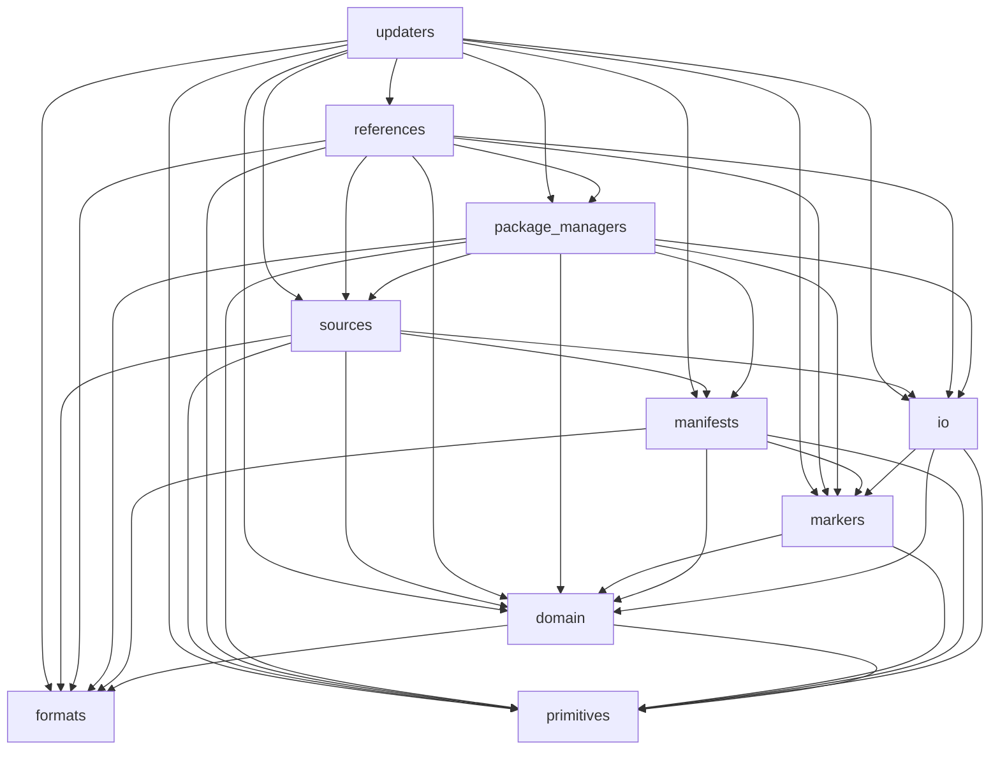

# Architecture

The package has a folder per layer. An arrow points from a layer to a layer it imports. The architecture tests in `tests/update_time/test_architecture.py` let a layer import only the layers ranked before it. Run `just architecture` to regenerate this document.

